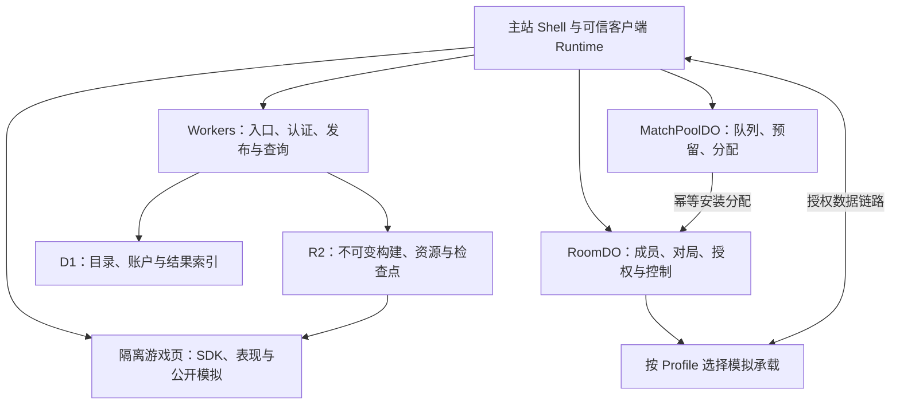

# PlayWithAnyone 系统架构与 SDK 协议规范

版本：**1.2**  
日期：2026-11-11  
文档类型：**软件架构与设计说明书（SAD / SDD）＋ SDK 与线协议规范**。  
状态：按已确认修订方向形成的目标架构；未确认产品策略保持未指定。  
对象：项目负责人、平台与游戏开发者、AI 编程工具、架构审查者。

本文是完整替代 v1.1 的规范，包含领域边界、部署映射、状态所有权、游戏模块合同、连接鉴权、字节格式、故障恢复、安全策略和符合性用例。它不规定开发顺序、里程碑或 MVP 范围。本文使用“必须／不得”表示实现约束，“可以”表示已定义合同内的能力；示例标识与测试数据不构成产品默认。

**硬约束：所有游戏使用平台 SDK、模块接口和平台协议。不存在第三方游戏后端、房间、账号或私有联机协议的兼容适配层。** 引擎或语言绑定只是同一 SDK 的调用映射。

## 阅读导航

- 看整体架构与实际取舍：第 1—5 章。
- 看匹配与开局的正确性：第 6—7 章。
- 看身份、线协议与热切：第 8—10 章。
- 看浏览器隔离、资源与部署：第 11—15 章。
- 看可交给实现者的验证合同：第 16 章，以及第 9、11 章的具体用例。
- 看哪些产品问题仍未决定：第 2 章、第 14 章。

## 1. v1.2 的修订结论

| 修订方向 | v1.2 的确定合同 |
| --- | --- |
| 删除无明确需求的机制 | 移除多设备输入合并、独立续玩分支及 `continuationId`；同一席位只有一个当前获授权输入会话 |
| 合并普通匹配所有权 | 一个 MatchPoolDO 及其 SQLite 共同拥有队列、预留、取消与分配；普通成局使用本地事务 |
| 收敛跨区搜索 | 选定**单一排队所有权转移**；其他区域只能给候选提示，不能同时签发最终分配 |
| 简化路径热切 | 已授权端点在 WS / WebRTC 间完成鉴权、接收就绪及水位对齐；不持久化路由 COMMIT |
| 收敛基础设施 | 核心依赖为 Workers、DO、D1、R2、TURN；固定高频模拟进程和专用 RTC / WT 网关仅属于需要它们的 Profile |
| 补齐执行合同 | 明确身份绑定、32 字节头、载荷、控制消息、ACK、缺口补发、CSP、资源路径、Cookie 隔离和故障测试 |

保留 `matchId` 与 `authorityEpoch` 的区分，保留可靠命令与输入历史、回滚、检查点、幂等结果和不可变游戏构建。这里减少的是无依据的分布式环节与假设能力，不削弱已经声明的交付、鉴权和恢复语义。

## 2. 已确认边界与未确认产品策略

### 2.1 已确认的产品方向

面向全球用户的陌生人网页联机小游戏平台，支持开房与随机匹配，目录只收录联机游戏，沿用免费网页游戏定位。本文不新增付费门槛，也不据此确认广告、会员、开发者分成等商业模式。

架构覆盖游客或账户身份、房间、队伍关系、按游戏或游戏集合匹配、多地区候选搜索、多种同步模型、重连、旁观、允许的中途加入、回放、结果记录与内容发布。这些能力不自动决定入口、默认开关、用户操作顺序或公开范围。

### 2.2 产品策略接口只保留实际边界

采用简单的带版本策略绑定，不建设可以穷举所有假想选择的通用策略引擎。

```ts
type PolicyBinding = {
  policyId: string;
  version: number;
  values: Readonly<Record<string, unknown>>;
};
type PolicyResolution<T> =
  | { status: "BOUND"; binding: PolicyBinding; value: T }
  | { status: "UNSPECIFIED"; requiredKeys: string[] };
```

`values` 必须经过所属能力的具体 schema 验证，不是可执行脚本。配置来源与生效范围明确记录；没有定义覆盖关系时，不自动采用“玩家覆盖房间”或“最后写入优先”。本局确实使用的策略在进入对应行为前解析并固定版本。

**未指定不等于开启、关闭、无限制或某个示例值。** 当某行为确实依赖尚未绑定的产品选择时，配置检查返回 `POLICY_REQUIRED`，只指出相关选择；不在玩家已进入行为后临时猜测。尚未被采用的能力不要求现在补齐全部配置，也不据此构建其所有可能实现。

常规工程选择仍由规范明确决定：例如本地事务、端序、消息上限、去重键和权限验证。这些不需要逐项产品审批。匹配等待多久、断线是否判负、补位方式、机器人是否接管、是否显示倒计时等产品问题不由技术参数代填。

### 2.3 本版明确承担的技术取舍

| 取舍 | 影响与边界 |
| --- | --- |
| 每席位一个当前输入会话 | 不定义多来源输入融合；不等于全账号只允许一个设备登录、一个排队或一场游戏 |
| 队列跨区采用所有权转移 | 转移期间可以暂时不可匹配；不会让两个池同时拥有最终分配权 |
| 可靠流与输入有界缓存 | 超出保存与恢复能力时明确背压或恢复；不声称任意断网都能无损、无停顿 |
| 路径状态不持久化 | 连接重建重新鉴权并对齐水位；游戏提交、席位授权与权威变更仍有持久依据 |
| 核心使用 Cloudflare 原生持久化 | 不引入 PostgreSQL、Redis 为必需依赖；不据此承诺固定 DAU 下的固定账单 |
| SDK 构建经过发布验证 | 浏览器隔离减少权限，不把任意恶意游戏代码视为可信，也不声称 CSP 能完整消除所有出站通道 |

## 3. 总体架构与物理承载



图中是职责，不是必须独立部署的服务清单。游戏数据面可走 WS 中继、直接 WebRTC 或经 TURN 的 WebRTC；具体端点由 Profile 决定。TURN 转发 RTC 流量，不成为游戏规则权威。

### 3.1 核心必需依赖

| 设施 | 职责 | 不承担的承诺 |
| --- | --- | --- |
| Cloudflare Workers | Web / API 入口、认证、SDK 控制接口、发布与数据服务；可用静态资源能力承载主站 | HTTP/3 支持不自动等于提供 WebTransport 游戏端点 |
| SQLite-backed Durable Objects | 每池匹配、每房间控制、事件规则、可靠 WS 路由及持久期限 | 不把单一 DO 当全球队列；不把单线程或内存索引等同于故障后持久性 |
| D1 | 账户与游戏元数据、发布索引、结果和统计事实 | 不进入逐帧输入路径，不代替各 DO 的本地事务 |
| R2 与受控资源域 | 不可变游戏包、资源、检查点与回放对象 | 免某类出站费不等于请求、计算、TURN 或总成本无限免费 |
| TURN | WebRTC 无法直连或明确采用 relay-only 时的中继 | 不鉴定席位身份，不执行游戏规则，不保证每种网络均可连通 |

DO 的存储为对象私有的事务与强一致存储；本地 SQLite 事务不能跨对象，也不能覆盖事务外网络副作用。[S1] 内存索引、连接偏好和可重建缓存可以丢失，已确认的分配与授权不能只存在内存。[S2]

### 3.2 按 Profile 才存在的依赖

固定高频 `server-snapshot` 需要具有相应调度、CPU 和隔离能力的运行实例。它可以由独立区域进程池承载；若某承载实现经过相同符合性验证，也可以替换其物理实现。普通 DO 的事件执行、Alarm 和生命周期不能被描述为硬实时 Tick 调度器。[S2]

服务端 RTC、WebTransport 或专用低延迟入口需要实际实现这些协议的端点。只有选用该承载的 Profile 依赖专用网关。普通 `server-turn`、由浏览器执行的锁步/回滚与玩家宿主配置，不需要为了存在而预先部署整个高频进程池。

“按需承载”是目标架构中的依赖关系，不是把功能延期实现的计划。发布和开局必须核验所需承载当前可用；不可用时返回明确能力不满足，不能偷偷换成不同的权威或同步模型。

### 3.3 区域与分片

匹配池按兼容条件和负载分片；Room 按 roomId 路由。不得设置所有请求都必须经过的全球 Tick DO 或全球匹配大锁。公开房间目录和供给提示可以由异步索引组成，过期索引只影响搜索效率，不能授予席位。

池所在地、Room 控制所在地、模拟执行所在地、玩家实际数据路径分别记录。DO 的位置提示不视为特定城市、持续固定位置或延迟 SLA。[S3] 地理分区影响数据约束时使用已验证的供应商能力及显式配置，不能用名称伪造保证。

## 4. 领域模型、身份与生命周期

### 4.1 必要实体和状态所有者

| 实体 | 含义 | 当前写入所有者 |
| --- | --- | --- |
| Player / Session | 平台身份及一个 SDK Runtime 的已认证逻辑会话；二者不等同于游戏席位 | Workers 身份模块及持久账户/会话记录 |
| QueueIntent / Assignment | 一次排队意图及其唯一正式分配 | 当前 MatchPoolDO |
| Room | 持续的组织空间、成员关系、管理权限及关联对局 | 对应 RoomDO |
| Match / Seat | 一次固定构建与规则的对局及参与角色、当前输入授权 | RoomDO；规则状态由它授权的模拟执行者推进 |
| GameRelease | 不可变构建、协议与能力声明 | 发布模块；D1 索引与 R2 对象 |
| Checkpoint / Result | 状态恢复依据、结果与证据 | 获授权运行时生成，Room 接纳，持久数据模块幂等写入 |

Party 表达持续一起玩的成员关系，Lobby 表达等待与发现视图；它们可作为 Room 所有者内的记录与投影，不要求独立 Actor。保留同伴、换游戏、重开使用明确命令；重开产生新的 matchId，可以保留 roomId。并未因此决定赛后默认操作。

Link 是已授权端点之间的连接上下文，不新增持久 Link Coordinator 服务。运行时分配、结果写入和策略解析也可以是现有 Worker / DO 内的模块，不由名词数量推导部署数量。

本文 Session 是一个 SDK Runtime 的逻辑会话，WS/RTC 和合法连接重建可延续它；主站登录 Cookie 是建立该会话的认证依据，二者不按“Cookie 相同”合并。新标签页或新 Runtime 不能自行声明旧 sessionId 成为同一输入写入者；平台创建其会话，续接/接管须取得对应的入场或恢复授权。同一合法输入会话的多条物理路径共享一个序号分配器。会话记录与授权由现有模块持有，不增加每设备独立 Actor。

### 4.2 身份与版本各自的职责

| 字段 | 作用域与变化条件 |
| --- | --- |
| gameBuildId | 精确不可变构建的完整 SHA-256 摘要；本局不变 |
| profileId / profileVersion、protocolVersion | 同步合同与字节协议版本；不兼容时显式拒绝或协商另一个双方实现的已发布版本 |
| queueIntentId / ownerEpoch / revision | 一次排队、它当前所属池的代次、其成员与条件版本；三者不混用 |
| roomId / matchId | 组织空间与一次规则执行；新一局更换 matchId，换网络或换权威不更换 |
| authorityEpoch | 本局规则执行/排序权的任期；换宿主、迁移或恢复执行权时由 Room 提升 |
| seatId / seatEpoch / inputSessionId | 席位与当前独占写入授权；inputSessionId 指被选为当前写入者的既有 Session.id，不另建输入会话系统；接管或撤销时更新 seatEpoch |
| logicalStreamId / seq / tick | 稳定逻辑流、消息次序、模拟帧；重传、换路径、同局恢复不清零逻辑身份 |
| descriptorId / contextTag / pathInstanceId | 已授权链路记录、线上短别名与具体路径实例；不是对局或执行权身份 |
| matchRevision | Room 生命周期乐观并发版本；不是每帧游戏状态版本 |

`ownerEpoch` 仅是排队所有权的代次。`authorityEpoch` 仅是模拟执行授权。数值更大不构成权限证明；相应所有者的已验证授权才构成依据。

当前核心协议没有多设备输入合并。一个席位的某 tick 只有一个规范输入，不能把两个设备的值按“最后到达”或未声明规则混合。是否允许接管、何时接管、是否需要提示属于产品策略；执行接管时必须完成旧授权隔离。

### 4.3 对局状态

Room 持久保存 `ALLOCATED / PREPARING / RUNNING / RECOVERING / TERMINAL` 和相应 revision。成员的资源就绪、链路就绪、基线就绪分别记录；READY 不是用一个布尔值代替全部条件。

开始由已经绑定的启动合同授权，可带参考时钟和起始 tick。规范不强制显示倒计时、不规定所有游戏必须同步倒数几秒。网络中断、退出申请、暂停与结束不是同一个事件；只有生命周期所有者可确认终态。

## 5. SDK、游戏模块与 Netcode Profile

### 5.1 游戏公开 API

```ts
interface GameClient<Command, Input, View> {
  readonly session: Readonly<SessionContext>;
  readonly capabilities: Readonly<NegotiatedCapabilities>;
  ready(): Promise<void>;
  actions: { dispatch(command: Command): Promise<ActionReceipt> };
  inputs: { submit(input: Input, tick: number): InputHandle };
  state: { subscribe(fn: (view: ViewEnvelope<View>) => void): Unsubscribe };
  effects: { subscribe(fn: (event: GameEffect) => void): Unsubscribe };
  lifecycle: { subscribe(fn: (event: LifecycleEvent) => void): Unsubscribe };
  assets: AssetAccess;
  clock: GameClock;
  diagnostics: Diagnostics;
  dispose(): void;
}
```

这是能力面；具体 Profile 暴露类型化子集，运行边界仍必须做 schema 校验。游戏不得自己创建私有房间、选择任意网络服务器、任命权威或绕过 SDK 发游戏流量。引擎可以是 JS / TS、WASM 或经过验证的 Web 导出，但都遵循这些接口。

`dispose()` 只结束当前表现实例与订阅；离开 Room、退出 Match、终止对局分别是明确的获授权命令。小游戏不能通过销毁 canvas 隐式让另一参与者被判负。

### 5.2 模块分工

| 模块 | 合同 |
| --- | --- |
| PresentationModule | 输入采集、画面与声音；不持有平台认证凭证，不以动画回调决定规则时间 |
| ServerGameModule | `create / parseCommand / parseInput / applyCommand / applyInputs / onDeadline / project / save / restore / evaluateResult`，按 Profile 实现所需函数 |
| SimulationModule | `init / step / save / load / hash / project`；可复制公开模拟，声明固定步长、数值、随机源和输入排序 |
| SDK Runtime | 身份上下文、网络、历史、确认、时钟、预测/回滚编排、受控资源与诊断 |

游戏模块输出状态变化、效果意图和期限，不自行操作平台数据库、网络凭证或不可追踪的计时器。规则时间和随机源由运行合同注入；恢复重放不使用当时的墙上时钟替换原事件时间。

包依赖划分为 `client / public-simulation / server-private / assets`。客户端与公开模拟不能导入 server-private。私有答案、手牌、隐藏地图或私有随机状态不能出现在 bundle、source map、全量视图或浏览器检查点中。用于公开确定性模拟的种子和规范状态可以公开；“渲染视图”不自动足够恢复模拟。

### 5.3 五类配置

| Profile | 权威与同步 | 核心承载 | 必须具备 |
| --- | --- | --- | --- |
| server-turn | 平台事件规则、离散动作、按观看者投影 | RoomDO 事件规则与 SQLite；WS | 校验、命令幂等、持久期限、原子状态/回执 |
| server-snapshot | 平台固定 tick；预测、纠正、插值 | 获授权高频运行实例；获支持的数据端点 | 输入确认、基线/增量、可见性过滤、检查点和恢复日志 |
| deterministic-lockstep | 一致输入集驱动相同模拟；明确输入排序者 | 平台排序 DO / Runtime，浏览器模拟，WS 或 RTC | 确定性、完整输入、状态哈希、不同步处理 |
| duel-rollback | 两名主动玩家交换输入、预测、回滚重算 | 浏览器模拟、RTC / TURN 或 WS 中继 | 快照环、输入环、确认帧、重演与副作用隔离 |
| peer-host-snapshot | 获任命玩家宿主推进规则 | Host 星形链路，RTC / TURN 或 WS 中继 | 宿主任期、状态投影、可恢复检查点、明确证据等级 |

`duel-rollback` 的双人限制是该 Profile 的技术合同，不是平台全体游戏的人数上限。其他人数或拓扑需要自己的版本化 Profile，不能给现有合同临时塞入额外写入方。

### 5.4 配置不可任意拼装

Authority、transport、syncModel、runtime 是不同维度，但发布只接受经过定义与验证的组合。WebRTC 的不可靠输入通道不改变谁有权判定规则；WS 的可靠传输也不自动使玩家宿主可信。

锁步排序服务若不执行规则，只证明输入次序；玩家报告、玩家宿主或双方相同状态哈希也不自动等于可信裁判。成绩用途另由产品策略决定，事实证据必须准确记录。

需要向某玩家保密的完整规则状态不能交给该玩家进行全量公开模拟。必要时使用服务端规则和视图投影；这是信息边界，不能靠 CSP 或宿主身份标签修补。

### 5.5 确认、预测与副作用

| 状态 | 精确定义 |
| --- | --- |
| RECEIVED | 指定接收端已按该流合同接收；不自动持久化 |
| APPLIED | 获授权模拟在指定 tick / revision 应用过该操作；可能仍在可回滚范围 |
| COMMITTED | 达到该 Profile 声明的持久性与恢复边界，提供可查询依据 |
| REJECTED | 对该稳定命令身份形成明确拒绝及原因；重复请求取得同一结果 |

预测效果使用稳定 `effectId`，支持确认与撤销；回滚重放不会重复计奖、写永久记录、重复发通知或无限播放同一音效。不可撤销副作用由已提交事实派生，使用幂等键写入 outbox。

## 6. 匹配、单一所有权与跨区转移

本章定义普通匹配与跨区搜索的唯一分配合同。普通匹配在一个匹配池的同一个 Durable Object 及其 SQLite 中完成。跨区采用**排队意图的单一所有权转移**；其他区域可以返回候选提示，但不能同时为镜像票据签发最终分配。

这是一种状态归属安排，不规定一名玩家只能玩一局、只能使用一个设备，或必须等待多少秒再扩区。并发参与、匹配权重、扩区时机和前台交互仍为未指定产品策略。

### 6.1 单匹配池内的原子边界

每个 `MatchPoolDO(poolId)` 共同拥有本池的排队意图、成员快照、暂存候选、预留状态、分配结果、取消记录和迁移记录。它们是同一个所有者内部的数据，不分别部署成必经的 Ticket Authority、Activity Authority 和 Proposal Coordinator。

候选检索、评分和索引可以在内存完成。最终分配必须在该 DO 的一个本地 SQLite 事务中，重新检查各意图仍为可分配状态、revision 仍匹配、必要条件仍满足，再同时消费这些意图并写入唯一 assignment。成功后通过可重试的 outbox 初始化目标 Room/Match。

同一事务不跨 DO，不在事务回调中等待网络调用。等待资源加载和逐帧游戏输入也不进入匹配事务。匹配池可按容量和兼容规则分片，但一份意图在某一时刻只有一个分配所有者。

**匹配池的位置与实际游戏运行地区分开。** 匹配池可以依据参与者到候选运行端点的测量结果，为对局选择另一个获支持地区；玩家的游戏数据不必经过匹配池所在地区。`poolId` 的名称本身也不构成供应商对具体城市部署的保证。

### 6.2 身份、意图和唯一性作用域

`queueIntentId` 表达一次可独立取消和分配的排队意图。单人、已有队伍、或者接受一组游戏，都可以形成一份意图。平台不以 `playerId` 作为全站唯一活动锁；同一玩家是否可以拥有多份意图，由已绑定的参与策略决定。

初始所有权不得由客户端随意声明：

1. SDK 为一次逻辑排队请求保存固定的 `originPoolId + requestId`。网络重试、连接重建和响应丢失后的查询使用同一组值，不自动去另一个池重新创建。
2. 仅 `originPoolId` 指向的 DO 可以创建初始意图。它使用 `(requesterId, requestId)` 的唯一键去重，并生成带该 origin 命名空间的随机 `queueIntentId`，初始 `ownerEpoch = 1`。
3. 同一 requestId 携带不同请求内容时返回幂等冲突，不能把它解释为更新意图。偏好或成员变化使用带预期 revision 的独立更新命令。
4. 其他池不能凭客户端提供的 queueIntentId 初始化一份新意图；它们只能接收经平台认证的所有权转移。

可以使用 `qi:<originPoolId>:<随机标识>` 的编码，也可以使用等价的不可伪造绑定。关键在于初始创建只有一个确定的入口，不能让两个池各自认为自己是同一意图的初始所有者。

### 6.3 必要数据与消息

以下结构表达协议必需语义，不要求逐帧携带这些字段。稳定上下文可在认证连接或入场阶段绑定。

```ts
type OwnerRef = {
  poolId: string;
  ownerEpoch: number;
};

type QueueIntent = {
  queueIntentId: string;
  originPoolId: string;
  requesterId: string;
  createRequestId: string;
  owner: OwnerRef;
  revision: number;
  state:
    | "QUEUED"
    | "TRANSFERRING"
    | "FORWARDED"
    | "ASSIGNED"
    | "CANCELLED"
    | "EXPIRED"
    | "CLOSED";
  rosterSnapshot: RosterSnapshot;
  criteria: MatchCriteria;
  policyBindingRef: string;
  createdAt: number;
  expiresAt: number | null;
  transferId?: string;
  nextOwner?: OwnerRef;
  assignmentId?: string;
};

type Assignment = {
  assignmentId: string;
  matchId: string;
  roomId: string;
  allocatorPoolId: string;
  intents: {
    queueIntentId: string;
    ownerEpoch: number;
    revision: number;
  }[];
  gameBuildId: string;
  profileId: string;
  rosterHash: string;
  runtimePlacement: RuntimePlacement;
  policySnapshotRef: string;
  state: "COMMITTED" | "ROOM_INSTALLED" | "CLOSING" | "CLOSED";
};

type TransferSpec = {
  transferId: string;
  queueIntentId: string;
  originPoolId: string;
  from: OwnerRef;
  to: OwnerRef; // ownerEpoch 必须等于 from.ownerEpoch + 1
  frozenRevision: number;
  snapshotHash: string;
  expiresAt: number | null; // 不因迁移自动延长原意图期限
};

type TransferDecisionRef = {
  sourcePoolId: string;
  transferId: string;
  sourceDecisionId: string;
  snapshotHash: string;
};
type TransferDecisionView = {
  spec: TransferSpec;
  decision: "FROZEN" | "RELEASED" | "ABORTED";
  sourceDecisionId: string | null;
  destinationImportReceiptId: string | null;
};
```

`RosterSnapshot` 含本意图参与成员和所需角色的不可变快照，不要求先存在 Party。`MatchCriteria` 分开规则所需条件、已生效硬约束与评分偏好；本章不填入自动扩区秒数、语言门槛或延迟阈值。ownerEpoch 属于每份 queueIntent，不是匹配池全局任期；一次 assignment 可以消费来自不同所有权代次的多份意图，分别记录各自代次。

`expiresAt` 是已绑定策略的运行结果：明确有排队期限时为时间戳，明确不按排队时长自动过期时为 `null`。`UNSPECIFIED` 不得写成 null；实际创建 QueueIntent 前，如果该选择仍未绑定，返回 `POLICY_REQUIRED`，不生成可匹配记录。本文不替产品选其中一种。RPC 超时、重试预算、凭证有效期和终态保留窗口是独立协议参数，不代替产品期限。期限不会因迁移延长，也不撤销已经作出的 RELEASED 决定。

所有转移入口仅供平台内部调用，不对公开 API 暴露任意 DO RPC 代理。目标通过部署中固定的 MatchPoolDO namespace 定位来源，调用 `getTransferDecision(transferId)` 读取其持久决议；不访问载荷中的任意 URL，不仅相信自报来源或 RELEASED 标志。STAGE 核验来源确实拥有该意图且转移记录一致；ACTIVATE 必须读到 RELEASED，并逐项核验完整 TransferSpec、sourceDecisionId 与本地导入回执；ABORT 必须读到不可反转的 ABORTED。核验结果持久化后，重复通知可用本地记录处理。

通知携带的 TransferDecisionRef 只是决议定位信息，不是可自行信任的签名凭证。首次核验时来源不可达，就保持未决；该可用性边界只发生在交接/恢复路径，不进入游戏逐帧路径。

平台内部消息至少包含：

| 消息 | 用途及幂等标识 |
| --- | --- |
| `CREATE_INTENT` | 向 originPool 创建或查询同一请求；按 requesterId + requestId 去重 |
| `UPDATE_INTENT` | 带 expectedRevision 更新仍可更新的意图；按 commandId 去重 |
| `CANCEL_INTENT` | 撤回指定意图；按 queueIntentId + commandId 去重 |
| `GET_INTENT` | 返回当前状态、已知所有者或迁移未决状态 |
| `STAGE_TRANSFER` | 在目标池保存不可匹配的导入快照；按 transferId 去重 |
| `RELEASE_TRANSFER` | 来源池作出持久转移决定；仅内部调用，不接受客户端自行发证 |
| `ACTIVATE_TRANSFER` | 目标池回读核验来源持久 RELEASED 决议后激活；按 transferId 去重 |
| `ABORT_TRANSFER` | 目标回读核验来源 ABORTED 决议，保存关闭 tombstone 并终结本次暂存导入 |
| `INSTALL_ASSIGNMENT` | 幂等初始化 Room/Match；按 assignmentId 和 matchId 去重 |
| `CLOSE_ASSIGNMENT` | 撤销尚未开始的分配，或按当前对局合同处理已开始活动；有持久关闭记录 |

命令带有调用者身份、目标作用域、稳定 commandId 和必要的预期版本。客户端超时后查询或重试同一命令，不换 ID 掩盖未知结果。

#### 本地存储的关键约束

| 记录 | 最小键或约束 |
| --- | --- |
| 初始请求 | UNIQUE(requesterId, createRequestId)，保存请求摘要与对应 queueIntentId |
| 排队意图 | PRIMARY KEY(queueIntentId)，记录当前 state、ownerEpoch、revision |
| 分配意图明细 | UNIQUE(queueIntentId)；本意图一旦分配，不再退回 QUEUED 复用 |
| 分配 | PRIMARY KEY(assignmentId)，UNIQUE(matchId)，保存完整初始化摘要 |
| 来源转移记录 | PRIMARY KEY(transferId)，终态 RELEASED / ABORTED 不可反转 |
| 目标导入记录 | PRIMARY KEY(transferId)，STAGED 状态不可参与搜索撮合 |
| 命令去重 | UNIQUE(scopeId, commandId)，保存已经完成的结果或未决状态 |
| outbox | 稳定 eventId、目的实体、载荷摘要、重试和确认状态 |

已终结意图如需重新排队，生成新的 queueIntentId；产品是否自动重排另行决定。这条规则用于隔离旧分配与新请求，不限制同一玩家的合法并行活动。

### 6.4 普通成局路径

普通候选搜索不授予席位，也没有跨网络等待的 PREPARED 阶段。候选可在内存计算；最终事务完成重新校验、意图消费和 assignment 提交，不等待 Room、玩家确认或运行时网络调用。若某个明确运行合同需要跨异步等待保留候选，预留也由同一池持久拥有，记录意图、预留标识、退出与恢复条件；预留中不可参与转移或其他分配。只有尚未成为 assignment 的预留才可按合同释放；已分配意图不得因超时退回 QUEUED。

1. `MatchPoolDO` 接受 CREATE_INTENT，在本地记录有效意图。可重建内存索引只用于寻找候选。
2. 匹配器找到候选后，进入本地事务，校验所有意图的 ownerEpoch、revision、QUEUED 状态和匹配条件；任一条件变化则放弃本次候选并重新搜索。
3. 同一事务生成 assignmentId / matchId，写入不可变 assignment 摘要，将涉及意图标记 ASSIGNED，并写入 INSTALL_ASSIGNMENT outbox。
4. RoomDO 收到 INSTALL_ASSIGNMENT，在自己的本地事务中安装该 matchId 的成员、构建与授权上下文。相同 assignment 的重试返回原结果；不同摘要复用同一 ID 返回冲突。
5. RoomDO 持久确认安装后，平台向各参与者交付可入场的 MATCH_FOUND / joinToken。资源预加载可以提前进行，但候选提示不授予正式席位。
6. 玩家按相应配置完成状态与资源就绪后，由 Match 的启动合同决定何时运行。匹配提交不等于所有资源已加载完成，也不承诺某个固定毫秒数。

INSTALL_ASSIGNMENT 的请求或回复丢失时，只重试同一个 assignmentId / matchId。池不能因此再消费同一意图生成第二个 Match。Room 初始化最终无法完成时，原分配进入可恢复的关闭流程；是否生成新的排队请求由产品策略决定。

### 6.5 跨区协议：仅转移未分配意图的所有权

一次意图可以扩展搜索范围，但不能在两个池同时拥有有效分配权。跨区采用下面这一种协议，不另设可同时发最终入场票的镜像队列。

**迁移前提：** 来源意图处于 QUEUED，没有 assignmentId，也没有为该意图导出的入场授权。ASSIGNED 意图不可通过排队转移协议迁移；已经成立的对局换地区属于运行时迁移合同。

#### 6.5.1 Freeze：来源冻结

来源池在本地事务中：

- 再次验证自己是当前 owner、意图仍为 QUEUED，且没有 assignment；
- 创建唯一 transferId，冻结 revision、成员及条件快照；
- 将意图改为 TRANSFERRING，立即从可匹配索引移除；
- 写出 STAGE_TRANSFER outbox。

此后来源池仍是该意图的写入所有者，但不能拿它成局。并发匹配事务与冻结事务由同一 SQLite 串行决定先后：匹配先成功则转移失败；冻结先成功则匹配重新找候选。

#### 6.5.2 Stage：目标暂存

目标池验证平台调用来源、目标 poolId、代次关系、冻结摘要和导入能力，并持久保存 STAGED 导入记录，然后返回稳定 importReceiptId。

导入回执同时承诺保存这份暂存记录并接纳后续经来源决议核验的合法所有权激活；必要的记录容量在暂存时预留。目标不能在不知道来源决定时，仅靠本地 TTL 删除记录或撤销该承诺。后续候选容量不足可以影响排队服务，不得成为来源已 RELEASED 后拒绝所有权的理由。

STAGED 记录不是活动队列项，不能参与撮合、产生 Room 或签发入场授权。收到更大的 ownerEpoch 本身不是授权依据；重复请求只能返回同一快照的回执，摘要不一致则拒绝。

#### 6.5.3 Release：来源作出不可反转的转移决定

来源收到目标持久导入回执后，在本地事务中检查该 transferId 仍未取消、意图仍被冻结，再写入 RELEASED 决定，将原记录改为 FORWARDED 并记录目标 OwnerRef。

来源在**确认决定已经持久化后**，通过 outbox 发送带 TransferDecisionRef 的 ACTIVATE_TRANSFER。目标按前述固定内部 RPC 回读并核验完整决议；通知本身不授予所有权。决议绑定来源、目标、前后 ownerEpoch、transferId、快照摘要及目标导入回执。

来源一旦 RELEASED，就永远不能因超时把该意图恢复为自己的 QUEUED 状态。目标暂时不可达时可以失去可用性，但不能恢复双重写入权。

#### 6.5.4 Activate：目标接管

目标回读核验 RELEASED 决议与本地 STAGED 记录一致后，在本地事务中建立当前意图状态，使用 `ownerEpoch = 原值 + 1`，并记录该 transferId 已激活。

- 未取消、未过期的意图进入 QUEUED，开始参与本池匹配。
- 已接收有效取消意图或已过期的导入，直接成为 CANCELLED / EXPIRED，不短暂进入可匹配状态。
- 重复 ACTIVATE 返回已有结果，不创建另一份意图。

意图的业务期限已经到达，不使先前持久化的 RELEASED 决定变成不存在；目标仍需完成所有权记录并将意图置为 EXPIRED，不能因而恢复来源写入权。

目标持久确认后，来源可记录激活回执用于恢复和回收，但该回执不改变来源已经放弃写入权的事实。

#### 6.5.5 决定前撤销与决定后故障

来源尚未 RELEASED 时，可以在本地事务中把本次转移决定为 ABORTED；目标仅能清理惰性的 STAGED 记录。取消整份意图时来源进入 CANCELLED；只是转移失败时，来源可恢复原 QUEUED 状态。是否继续搜索或选择另一区域由已经绑定的策略决定。

目标收到 ABORT_TRANSFER 后，回读核验来源的 ABORTED 决议，并保存以 transferId 为键的关闭 tombstone，即使 STAGE 尚未到达。记录绑定完整 TransferSpec；迟到的 STAGE / ACTIVATE 不得重新建导入，相同 ID 不同摘要返回冲突。该 tombstone 只终结本次转移，不提高目标的有效 ownerEpoch，不妨碍来源以新 transferId 发起同代次的另一次合法尝试。合法重试窗口结束后迟到请求返回过期，不按新导入执行。

RELEASED 与 ABORTED 由来源同一事务状态串行裁决，不能同时成立。ABORTED 记录不产生有效已核验的释放决议，迟到的 STAGE 或回执不能使它复活。已经 RELEASED 的转移不再提供“回滚到来源”按钮；如果以后要返回原池，必须由当前目标 owner 发起一轮新的转移。

迁移超时只触发查询、重试或在尚可撤销时作出 ABORTED 决定。任何一方都不能只凭本地超时自行宣布接管或恢复所有权。

### 6.6 取消、路由和旧授权隔离

#### 6.6.1 无全局目录的路由

SDK 保存最近收到的 OwnerRef。来源 FORWARDED 记录提供新的 owner 和转移标识；请求可通过 originPool 或已知旧 owner 得到重定向，再向当前 owner 重试同一命令。

这些是各池已有记录中的转发信息，不另建一个所有请求必经的全球目录。多次转移保留按 ownerEpoch 单调前进的引用；目标不能凭客户端自报的位置恢复所有权。实现应限制单次路由追踪与重试工作量，超过限额返回可重试的解析未决状态，不能任意改投一个新池。

活跃意图的必要转移记录不能由普通 TTL 删除。终结记录保留至已声明的命令重试窗口、转移协议请求和入场凭证都不能再被合法使用；过期请求返回过期，不能重新执行为一份新意图。

#### 6.6.2 取消与转移竞争

- **取消在来源 RELEASED 之前被持久处理：** 来源决定 ABORTED，并将意图置为 CANCELLED；目标没有已核验的释放决议，无法激活。
- **取消在来源 RELEASED 之后到达：** 来源不再自行修改意图业务状态；保存向目标投递的取消 outbox，返回“转交中”和目标引用。最终取消回执由当前 owner 持久处理后产生。
- **目标先收到取消、后收到激活：** 暂存取消请求；取得有效已核验的释放决议后直接激活为 CANCELLED。
- **目标已完成分配才收到取消：** 进入已成立 assignment 的关闭或退出处理，不声称这份分配从未发生。

来源 RELEASED 后转交取消，须先验证调用者有权撤回该意图，再持久保存原 principal、commandId、摘要、transferId、目标和 outbox。目标对内部转交通过固定 namespace 回读该已认证请求记录，并按本意图权限校验 principal；不能仅凭“某个池发来的取消”就接受。目标直接收到通过正常认证的客户端取消时，不需绕回来源验证另一副本。

目标将合法取消保存为独立 pending command，在激活事务内检查，存在则直接进入 CANCELLED。重复/迟到 STAGE 不能覆盖它；pending command 自己不创建可匹配意图。正常 RELEASED 前已有目标持久 STAGED 回执，因此取消可以先于 ACTIVATE 或重试 STAGE，不会合法地先于首次持久 STAGE。目标若已再转出，按相同授权和去重合同转交给下一 owner。最终回执由当前 owner 持久处理后产生。

本地点击退出、取消请求已发出、平台已持久确认撤销是三种不同事实。客户端不因迟到响应自动为已本地取消的该次请求发送 READY 或新输入，但服务器状态以它实际接收并提交的命令为准。前台是否等待确认、返回大厅或参加另一项获准活动，不由本章预设。

#### 6.6.3 Room 只接纳已经安装的分配

joinToken 至少绑定 assignmentId、matchId、roomId、精确构建、席位或参与身份、授权上下文和有效期。RoomDO 只接纳与其已安装 assignment 相符、且未被撤销的票据；**客户端持有一个签名 token，不能据此让不存在的 Match 自行变成有效对局。**

入场票与对局的安装不能先于分配事务提交。排队转移又严格禁止已分配意图，因此旧来源在转移后没有可合法继续签发的旧 assignment。

Room 还必须为 CLOSE_ASSIGNMENT 保存关闭 tombstone，即使相应 INSTALL_ASSIGNMENT 尚未到达；迟到的安装消息不能覆盖关闭决定。若 Match 已经开始，关闭请求按该局当前生命周期和退出合同裁决，不追溯把它当成未发生。

同一 queueIntentId 不在终结后重新排队复用。这个限制使旧 Room 的票据、取消消息和初始化重试只能影响旧 assignment，不能侵入下一次新意图。旧 Match 的网络连接如被复用，也必须重新绑定新 matchId 与授权上下文。

### 6.7 正常与故障示例

| 情形 | 协议结果 |
| --- | --- |
| A、B 在同池匹配 | 同一本地事务消费两份 QUEUED 意图并记录 assignment；Room 安装成功后发入场信息 |
| 撮合算法看见过期内存索引 | 本地事务复核 state / revision 失败，不发票，重新找候选 |
| MATCH_FOUND 回复丢失 | 按原 requestId / queueIntentId 查询，返回同一 assignment，不再匹配一次 |
| Room 已安装，但安装回执丢失 | outbox 重试相同 assignmentId，Room 返回原安装结果 |
| 来源冻结后重启 | 从 TRANSFERRING 及 outbox 恢复，继续暂存导入或在可撤销条件下 ABORT |
| 目标暂存后重启 | 从 STAGED 记录恢复；没有已核验的释放决议仍然不可匹配 |
| 来源已经 RELEASED，但 ACTIVATE 丢失 | 来源恢复 outbox，或目标查询来源取得同一决议；来源不能重新排队 |
| 目标激活后回执丢失 | 重复 ACTIVATE 返回同一当前状态；不得再导入一份 |
| 取消消息比 Room 安装先到 | Room 记录关闭 tombstone，迟到安装被拒绝 |
| 已分配的意图请求跨区 | 拒绝排队所有权转移；若需要迁移现有游戏，使用独立运行时迁移合同 |
| 目标在来源 RELEASED 后长时间不可用 | 本意图等待目标恢复；不由来源超时夺回，不承诺零等待 |

#### 双区域竞争反例与本协议的处理

若亚洲和欧洲同时把同一意图视为可匹配，它们可能分别为 A+B 和 A+C 签发入场票。客户端后来选择较小 roomId，不能撤回另一局已经发生的入场或开局。

本协议中，来源冻结后不能再成局，目标核验释放决议前也不能成局。因此不会出现两边都合法签发最终 assignment 的窗口。迁移期间可以暂时没有可分配的所有者，但不会同时有两个。

### 6.8 不变量与明确限制

1. 同一逻辑 CREATE 请求只由 originPool 初始化；其他池不从客户端自报 ID 创建初始所有权。
2. 每个 queueIntentId 在同一时刻至多由一个池拥有有效分配权。
3. 普通成局涉及的意图消费与 assignment 写入在同一池的本地事务完成。
4. 同一 queueIntentId 只产生一份正式 assignment；未知响应不等于未成功。
5. STAGED 导入不可匹配；来源 RELEASED 后不可恢复原写入权。
6. 转移只作用于未分配的 QUEUED 意图，不转移已经存在的 Room 或游戏执行权。
7. 客户端选择、连接关闭和本地超时不能伪造服务端 ABORT、RELEASED、取消或正式入场事实。
8. Room 的安装和关闭幂等，关闭 tombstone 阻止迟到安装复活旧对局。
9. 候选和索引可以重建；已确认所有权、分配与撤销需要持久依据。
10. 未决恢复和跨区移交存在可用性边界，不承诺“0.5 ms 成局”或无条件零等待。

这个方案不支持同时从多个池竞争消费同一份意图。跨池凑人时，须将所需的未分配意图转移至一个共同池后再执行普通匹配；转移失败时不能退回多个区域各自发票。候选发现可以并行，最终消费必须回到同一个所有者。

同一玩家多份独立意图的总量、互斥活动或账号级并发限制不由本协议自动提供，也不被本协议禁止。若产品以后明确要求跨所有池的账号级互斥，需要另行定义相应授权边界，不能把这种尚未确认的规则偷偷塞进每次匹配热路径。

## 7. Room 安装、开局、授权与控制命令

### 7.1 最小控制合同

客户端入口与内部操作都使用 `requestId / commandId` 去重、明确作用域和请求摘要。相同 ID 不同载荷返回 `IDEMPOTENCY_CONFLICT`。Room 生命周期变更携带 `expectedMatchRevision`，冲突时返回当前版本，不能自动覆盖其他已确认命令。

| 控制命令 | 所有者及关键验证 |
| --- | --- |
| CREATE_ROOM / JOIN_ROOM / LEAVE_ROOM | Room 成员关系、当前邀请/访问授权；公开目录只是候选来源 |
| INSTALL_ASSIGNMENT / CLOSE_ASSIGNMENT | Room 检查内部调用来源、稳定 assignmentId、matchId 与摘要；关闭记录可先于安装存在 |
| READY | 具体席位当前输入会话；绑定 build、profile、资源及基线就绪，不接受旧页面回执 |
| START_MATCH | Room 核验已绑定启动合同、成员及运行承载；生成固定启动上下文 |
| REQUEST_TAKEOVER / LEAVE_MATCH | 先校验产品权限，再按席位与生命周期合同隔离旧授权 |
| RECONNECT / GET_STATUS | 返回当前 Match、Seat、authorityEpoch、回执与恢复基线；不以客户端旧状态覆盖服务器 |
| FINISH_CANDIDATE | 当前执行权提交结果候选及证据；Room 校验后冻结终态并写结果 outbox |

这些命令是 SDK 控制面，不混入游戏逐帧输入。输入每帧不再读取全局账户库、匹配池或 D1。

### 7.2 入场和准备

Room 安装完成后签发或建立短期、单局、单席位/角色的 JoinGrant。JoinGrant 至少关联 assignmentId（直接房间开局可无排队 assignment）、roomId、matchId、精确 build/profile、playerId、inputSessionId、seatId、seatEpoch、角色、端点用途和有效期。

JoinGrant 在本规范中采用**高熵不透明令牌＋服务端授权记录**：令牌至少 256 位随机，服务端仅保存其摘要，绑定当前已认证会话并校验全部作用域。令牌不得出现在 URL、日志、资源地址或游戏 iframe 中。它是平台入场凭证，不发给 RTC 对手；获取令牌不等于已开始，也不能从令牌创建一个未安装或已关闭的 Match。

初次绑定、查询与合法重试必须幂等。撤销、过期和 seatEpoch 改变都会使旧授权不能用于新连接。授权有效期、协议重试窗口等安全/资源参数有版本和边界；它们不直接规定“超时判负”之类产品结果。

### 7.3 一局开始前固定的上下文

至少固定 matchId、gameBuildId、规则版本、Profile、公开/私有状态 schema、成员与角色、初始 authorityEpoch、随机初始化合同、数据通道与流表、所需策略绑定、资源预算和恢复合同。

START 可以携带 `START_AT` 参考时间，也可以用于事件配置的逻辑开始。READY 汇合条件由所选玩法和已绑定策略提供；不统一规定所有玩家、固定秒数、自动踢人或机器人补位。

### 7.4 退出、重开与取消

关闭旧 Match 后再开一局必须使用新 matchId。房间可继续存在；新局不能复用旧 contextTag、基线或未撤销席位凭证。是否保留同伴、更换游戏、换陌生人或自动重新排队，只是对应产品命令的授权结果。

取消请求已发出与取消已持久确认分别向调用者暴露。SDK 不因迟到 MATCH_FOUND 自动为已本地取消的请求 READY。取消与已开始对局竞争时，报告实际状态并执行已绑定退出合同，不能伪装对局从未成立。

## 8. 连接身份绑定与端到端鉴权

### 8.1 授权来源和攻击边界

WSS / HTTPS 提供客户端到平台的认证链路，WebRTC 使用 DTLS 保护端点间的数据。平台 Room 控制信令绑定“哪个已认证会话有权代表哪个端点”与 SDP 中的 DTLS 证书 fingerprint；仅仅知道 matchId、seatId、contextTag 或握手 nonce 不产生权限。[S5][S6]

客户端只接受**自己通过已认证平台信令取得**的 LinkDescriptor。对手发来的对象、较大的 authorityEpoch 或自报 seatId 都不是授权。该方案不另引入共享 HMAC secret、设备 PoP 密钥体系或每次切换都持久化的认证事务。

```ts
type EndpointBinding = {
  endpointId: string;
  clockDomainId: string;         // 该端点单调时钟实例，不与另一端混用
  kind: "PLAYER" | "RUNTIME" | "SPECTATOR";
  playerId?: string;
  sessionId?: string;
  inputSessionId?: string;
  seatId?: string;
  seatEpoch?: number;
  runtimeInstanceId?: string;
};
type StreamBinding = {
  streamId: number;             // 1..65534，在本 Link 内唯一
  logicalStreamId: string;      // 同局恢复时保持的稳定流身份
  fromEndpointId: string;
  toEndpointId: string;
  kind: "COMMAND" | "INPUT" | "STATE" | "BULK";
  codecId: string;
  codecVersion: number;
  firstPosition: number;        // 新 COMMAND/BULK 从 0；INPUT 从授权起始 tick；恢复由合法基线给出
};
type LinkDescriptor = {
  descriptorId: string;         // 平台生成；绑定记录不可就地改义
  roomId: string;
  matchId: string;
  gameBuildId: string;
  profileId: string;
  profileVersion: number;
  protocolVersion: 1;
  authorityEpoch: number;
  endpoints: [EndpointBinding, EndpointBinding];
  contextTag: string;           // 16 位小写 hex，u64 的字符串表示
  streams: StreamBinding[];
  permissions: string[];        // 所选 Profile 定义的封闭权限枚举
  validFromMs: number;
  validUntilMs: number;
  limits: {
    maxFrameBytes: number;
    maxControlBytes: number;
    maxBufferedBytes: number;
    historyBytes: number;
    maxBulkBytes: number;
    maxConcurrentBulk: number;
  };
};
type PathAuthorization = {
  descriptorId: string;
  pathInstanceId: string;
  transport: "RTC";
  fingerprints: [
    { endpointId: string; sha256: string },
    { endpointId: string; sha256: string }
  ];
  validUntilMs: number;          // 不超过所引用链路授权的有效期
};
```

LinkDescriptor 的身份、流与权限映射不可就地改义。后建 RTC 路径使用与之关联的 PathAuthorization；它也是本端从已认证 Room 信令取得的授权记录，只补充该路径的 fingerprint，不修改同一 contextTag 的逻辑含义，不引入新的服务或路由提交事务。新证书/路径生成新 pathInstanceId；权限本身变化则更换 LinkDescriptor 和 contextTag。

`fingerprints` 每个 RTC 端点恰好一个 SHA-256 值，解析为 32 bytes 比较，格式统一为 64 位小写 hex。SDP 的冒号分隔表示必须规范化，不能按模糊前缀比较。平台把 fingerprint 记录到实际发送该 SDP 的已认证端点，不能相信 SDP 附带的用户名就是会话身份。PLAYER / SPECTATOR 端点必须绑定真实 sessionId；主动输入端点的 inputSessionId 必须等于当前席位已授权的 Session.id。RUNTIME 端点由平台内部身份与 runtimeInstanceId 绑定，不能由浏览器声明。

### 8.2 WSS 的具体绑定

本节描述承载 Match 数据的连接；排队、目录和普通房间操作可经已认证 HTTP API 完成，不要求未匹配的玩家先持有 JoinGrant。

1. 平台只在允许的 HTTPS 主站 Origin 接受浏览器 WSS，精确校验 Origin；使用主站会话认证和 CSRF 合同，不能把“浏览器自动带 Cookie”当作完整防护。
2. 第一个应用消息为 `AUTH_JOIN`，携带 JoinGrant、协议能力和稳定 requestId。同源入口验证 Cookie 的登录身份确实拥有令牌所绑定且仍有效的 SDK Session。区域直连入口不会收到主站 host-only Cookie，它通过平台内部入口核验 JoinGrant 的摘要记录、绑定的当前有效会话、允许的目标端点、Room 状态、席位/角色、seatEpoch 与有效期，再据此建立 socket 的受限会话身份；不能相信客户端自报 sessionId。这种身份只授权本连接及相应 Match，不授予账户 API 权限。
3. 服务端给 socket 安装 endpointId、允许的 match、描述符、流与接收目标，并返回 `AUTH_ACCEPTED`。鉴权前除限定握手外拒绝业务帧；大小、频率与认证等待有技术预算。
4. 转发时用**已认证 socket 身份＋contextTag＋streamId**验证实际发送端及目标。客户端改头部数字不能变成另一个玩家。ACK 必须来自该目标流的接收端；普通数据必须来自发送端。
5. 已认证 socket 可承载获授权的多个 Link，但每个 Link 都有独立绑定与预算。物理 socket 的复用不决定产品上的并发参与规则。

服务端恢复、部署或休眠唤醒不能凭仅有的内存映射扩大权限。可用受支持的连接附件恢复有限上下文，再校验当前授权；无法恢复则重新 AUTH / BIND。业务与去重状态从相应持久边界恢复，不用“连接仍开着”推断规则未丢失。[S2]

JoinGrant 的首次入场有效期与已经建立的 Link 授权有效期分别校验。入场令牌到期不自动等于已获准的链路租期到期；后者依据实际 LinkDescriptor 及 Room 撤销记录处理。区域内部认证查询只走固定平台绑定，不把客户端提供的 URL 当作授权服务器。

### 8.3 RTC 的具体绑定

1. SDK 在可信 Shell 侧建立 RTCPeerConnection，经已认证 Room 信令交换 SDP / ICE。每条 SDP 信令绑定 descriptorId、pathInstanceId 和经过认证的发送 endpointId；接收方先验证该端点确属当前 Link，再处理 offer / answer，避免等待双方最终回执才允许生成 answer 的循环。
2. 双方 fingerprint 取得后，Room 信令交付 PathAuthorization。本端在接纳业务路径前，将实际 remote SDP fingerprint 与该授权记录比较；DTLS 握手证明连接对端持有相应证书私钥。描述不匹配、端点已撤销或权限过期时拒绝。此 Profile 的 SDP 只授权所声明的数据通道会话，不顺带授予音视频采集/媒体轨权限。
3. `LINK_BIND / LINK_BOUND` 只引用已通过平台认证取得的 descriptorId 与 contextTag；不能因对手发送 LINK_BIND 就授权新的 Match 或席位。
4. `PATH_BIND / PATH_READY` 用随机 nonce 确认这次路径的必要通道接收器已经安装。每个发送方独立完成方向性就绪，双方反向发送也各自验证。先有身份绑定，再有就绪确认。
5. 该上下文通过 WS 与 RTC 收到的业务共享逻辑去重及水位。普通路径切换不再由 Room 持久记录哪个路径“赢得提交”。

RTC 授权不要求让客户端自行校验平台自创签名；信任锚是本端已认证的平台控制信令。平台可以复用一份有效的已安装授权来切换路径，但不能从未认证对端补出缺失授权。新 RTCPeerConnection 的证书或路径实例改变时需新的 PathAuthorization；端点/权限改变时需新的 LinkDescriptor。

### 8.4 权限更新和接管隔离

Room 持久记录 authorityEpoch、席位输入授权与撤销。新执行者或新输入会话只能在旧授权对全部必要消费者已被隔离，或旧授权明确到期后激活。隔离可以是消费者确认撤销、连接关闭及拒绝旧代次；不能仅更新 Room 一行数据就假定失联 peer 已立即得知。

接管同时固定规则运行时认可的输入生效 tick 与命令恢复水位，新写入者从获准的下一可写位置开始；不能因为 seatEpoch 变大就改写已经接纳的同 tick 输入或重用已执行命令序号。Input 流的 firstPosition 和恢复基线提供该边界，原有已接纳事实继续参与去重。

授权采用有限有效期，续期必须由当前 Room 权威确认。客户端时钟检查使用经过平台参考校准的时间与不确定性边界；不确定性过大时不能延长有效期。可信服务端也验证当前代次，客户端验证不代替服务端授权。

这些规则防止两个合法运行实例同时被平台当作当前权威。恶意玩家仍可能在自己的浏览器运行任意程序或谎报状态；协议不把玩家进程升级为可信服务器。

### 8.5 控制面失联

本版没有独立续玩 ID、旁支战绩、控制面失联后的自治成员变更或脱离原 Match 的规则权威。只可在当前尚有效的正常授权范围内处理已获准消息；需要续权、重新入场、换宿主或更换席位时必须重新获得平台授权。

无法证明授权仍有效时，停止接纳新的权威状态变更并报告 `CONTROL_UNAVAILABLE / AUTH_EXPIRED`。保留最后画面和历史不等于另开一场比赛。等待、暂停、退出或最终结束怎样呈现和裁决，由对应产品/玩法策略决定；SDK 不擅自判负或生成“已正式完成”的结果。

## 9. 线协议、可靠历史与端到端热切

本章定义链路、字节格式、输入补齐与测试合同。产品的等待时长、掉线判负、是否继续原同伴等不在此设置默认。核心输入模型为每个席位一个当前获授权写入会话；同一玩家的其他对局不受此模型限制。

### 9.1 上下文与逻辑身份

完整的 `LinkDescriptor` 只能由本端从已认证 Room WSS 控制信令取得，以不可变 descriptorId 标识，至少绑定 matchId、完整 gameBuildId、profile/version、authorityEpoch、双方端点、seatId、seatEpoch、当前 inputSessionId、流声明、有效权限；RTC 路径另由平台认证的 PathAuthorization 绑定双方 SDP 的 DTLS SHA-256 fingerprint。LINK_BIND 只引用本端已经安装的 descriptorId；对端自称的描述符不能产生授权，缺少记录时须经平台确认。JoinGrant 仅用于客户端向平台的 AUTH_JOIN，禁止发给 RTC 对手。RTC 必须核对 remote SDP fingerprint 与平台授权记录一致，并由 DTLS 握手验证相应私钥；nonce 本身不代替身份验证。认证 socket 绑定及授权撤销由第 8 章定义，无需另加 JWS、设备 PoP 或共享 secret 体系。

每条已认证的双向逻辑 Link 使用一个 `contextTag`（随机 u64；JSON 表示为恰好 16 位小写十六进制字符串），其中各有向流分别登记发送方与接收方。它是完整已验证上下文的短别名，不是访问令牌。建立方申请别名后，两端及涉及的 WS 中继检查其映射不冲突；相同 tag 绑定不同上下文必须拒绝并重新生成，不能覆盖旧映射。当前会话存续期内不复用 tag。

同一已绑定上下文可同时走 WS 与 RTC。WS 中继使用认证 socket、contextTag、消息类型及流映射查出获准的来源与目标，不能相信客户端自报 seatId，也不能向未授权目标转发。数据消息只能由该流登记的发送端提交；ACK/GAP_REQUEST 只能由该流登记的接收端发回发送端。接收方只接受已经安装并就绪的 contextTag；业务数据先于绑定到达时拒绝，不能据数据包自行创建上下文。

新 authorityEpoch、席位权限或输入会话授权生效时重新绑定上下文并撤销旧上下文。重新绑定同一 Match 不重置可靠命令身份、输入 tick 或已提交事实；旧消息可以由当前获授权写入者使用新上下文重传。易失的 RECEIVED 水位不冒充持久事实：接收端重启后，新上下文根据真实恢复基线重新建立传输水位，可以低于旧上下文丢失的接收水位；仍有历史则补发，没有足够历史则显式恢复/报错。旧 ACK 不能套进新接收上下文。

逻辑去重身份为：

- 命令：`(matchId, seatId, logicalStreamId, commandSeq)`。
- 输入：`(matchId, seatId, tick)`；若 profile 使用多种输入记录，须先合成为该席位该 tick 的规范输入。
- 快照：由获授权状态流的 `(matchId, logicalStreamId, stateSeq)` 标识，并绑定本次权威上下文。

contextTag、路径名称和 authorityEpoch 不进入同局命令或输入的逻辑去重键。上下文负责权限检查，稳定逻辑身份负责重复处理，两者分别判断。

### 9.2 32 字节固定头（Protocol Version 1）

所有整数和 IEEE-754 浮点字段均使用 Little-Endian。每个 WebSocket binary message 或 RTCDataChannel message 恰好携带一帧，不拼接多帧。文本消息只用于第 9.7 节控制 JSON。本文的二进制头固定为 32 bytes。

| Offset | 字节数 | 字段 | 精确定义 |
| --- | --- | --- | --- |
| 0 | 2 | magic:u16 | `0x5750`，线上字节 `50 57`（PW） |
| 2 | 1 | version:u8 | `1` |
| 3 | 1 | opcode:u8 | 见消息表；未知值拒绝 |
| 4 | 2 | flags:u16 | bit0=HAS_TICK；bit1=FULL_STATE；其他位必须为 0 |
| 6 | 2 | streamId:u16 | 当前上下文登记的有向逻辑流别名；0 为链路辅助消息 |
| 8 | 8 | contextTag:u64 | 已绑定上下文别名；JS 可用两个 u32 读取，不能转成有精度损失的 Number |
| 16 | 4 | seq:u32 | 按本消息类型解释的流序号；不等于模拟 tick |
| 20 | 4 | tick:u32 | HAS_TICK=1 时为该消息的模拟时间；否则必须为 0 |
| 24 | 4 | payloadBytes:u32 | 不含 32B 头；必须等于真实消息长度减 32 |
| 28 | 4 | reserved:u32 | 必须为 0 |

协议资源常量：`MAX_FRAME_BYTES = 16384`，因此 payloadBytes 最大 16352；`MAX_CONTROL_JSON_BYTES = 65536`；`MAX_GAP_RANGES = 32`。这是本协议版本的解析和资源边界，不是游戏产品默认，也不是 IP MTU 或“绝不分片”保证。配置可以进一步限制发包大小、并发、历史条数和内存，不能放宽本版本硬上限。RTC 实际消息还受已协商的 `RTCSctpTransport.maxMessageSize` 约束，发送上限取协议、描述符和底层能力的最小值；不能把 16 KiB 当成所有端点天然可发送的保证。大对象使用有界分块，控制对象超出候选路径能力时通过获准可靠入口发送或报告能力错误。

数据 seq 从 0 开始，只使用 `0..0xfffffffe`；`0xffffffff` 保留用于边界和哨兵。禁止自然回绕。耗尽前报告 SEQ_EXHAUSTED，并通过明确授权的新逻辑流或新 Match 继续；不能清零同一逻辑流伪装重启。新路径和重新绑定不会重新开始序号。输入 tick 同样不自然回绕。

解析顺序：检查总长度、magic/version、opcode/flags 组合、reserved、payloadBytes、上下文与流权限，再读取类型载荷。任何失败不得改变游戏状态、接收水位或确认状态。未知字段组合不能当作兼容扩展猜测解释。

### 9.3 流与 opcode

流按方向独立，每个 streamId 在当前 LinkDescriptor 中恰好绑定一个发送端、一个接收端、一种流类型和一个稳定 logicalStreamId。正反两方向不能复用同一个 streamId；示例中 A→B 使用 1=COMMAND、2=INPUT、3=STATE、4=BULK，B→A 可使用 0x8001..0x8004。流别名在同一上下文中不复用，重新绑定时须映射到原有的稳定逻辑流身份；不能仅因某个短别名数字相同就共用业务去重状态。新增逻辑流须通过显式 STREAM_OPEN 授权登记，不由业务帧隐式创建。

ACK 和 GAP_REQUEST 的 header.streamId 指被确认或请求补发的有向流，因此 ACK 实际发送者必须是该流的接收端。正常数据帧的实际发送者则必须是该流的发送端。这项区别由 opcode 和认证端点共同校验，不靠客户端自报来源。

| opcode | 名称 | 允许流 | seq 语义 | tick/flags |
| --- | --- | --- | --- | --- |
| 0x01 | COMMAND | COMMAND | 稳定逻辑命令序号，重发不变 | tick=0，flags=0 |
| 0x02 | INPUT_BATCH | INPUT | 本批数据包的序号；每条输入另按 tick 去重 | HAS_TICK=1；tick 为批次最后一条输入的 tick |
| 0x03 | STATE | STATE | 状态快照序号 | HAS_TICK 按 Profile 的固定 tick 能力；无 tick 时该位为 0、tick=0；FULL_STATE 可选 |
| 0x04 | BULK_CHUNK | BULK | 稳定分块消息序号，重发不变 | tick=0，flags=0 |
| 0x10 | ACK | 其头部 streamId 所指目标流 | 必须为 0，不产生 ACK 的 ACK | tick=0，flags=0 |
| 0x11 | GAP_REQUEST | 其头部 streamId 所指目标流 | 必须为 0 | tick=0，flags=0 |
| 0x20 | CLOCK_PING | 0 | 必须为 0 | tick=0，flags=0 |
| 0x21 | CLOCK_PONG | 0 | 必须为 0 | tick=0，flags=0 |

COMMAND 在其逻辑流内按序交付；不同逻辑流不假设天然全局顺序。一个 valid COMMAND 的游戏规则拒绝仍须产生确定的应用回执，不让已分配序号成为永远无法填补的洞。INPUT 可乱序接收和补齐；STATE 可丢弃已被更新状态取代的消息；BULK 有独立低优先级队列。

接收端按 Profile 已声明的乱序容量、输入时域和队列预算验证 seq / tick。异常远未来的数字不得触发无界扩容、跳过缺口或直接推进模拟。`server-turn` 用 stateSeq / 规则 revision 表示事件状态，不伪造固定 simulationHz 或把消息序号当作物理帧。

#### 9.3.1 原生通道映射

| 路径/通道 | 具体参数 | 承载 |
| --- | --- | --- |
| WSS | 一个应用 message 对应一帧；JSON 为 text，游戏载荷为 binary | 所有已授权流；应用调度不能消除 TCP 队头阻塞 |
| RTC `pwa.reliable` | 双方创建 `negotiated:true, id:0, ordered:true, protocol:"pwa/1"`；不设置 maxRetransmits / maxPacketLifeTime | 绑定/控制 JSON、COMMAND、ACK/缺口、BULK |
| RTC `pwa.fast` | 双方创建 `negotiated:true, id:1, ordered:false, maxRetransmits:0, protocol:"pwa/1"`；不同时设置 maxPacketLifeTime | INPUT_BATCH、可替换 STATE、时钟探测；必要输入可靠性由历史/ACK 协议补足 |

双方必须校验实际通道 id、label、protocol、ordered 和可靠性参数，以及 SCTP 通道数与消息尺寸能力；只设置 `ordered:false` 不等于关闭重传。预协商要求两边创建对应通道，不消除 ICE、DTLS 和 SCTP 建立过程。[S5][S7] ACK 与缺口也可以从另一条已就绪的可靠路径送达，不能假设 reliable 通道的消息一定先于 fast 到达。

v1 的精确帧映射覆盖 WSS 与 RTC。可选 WebTransport 承载在首条可靠控制流执行相同 AUTH_JOIN / AUTH_ACCEPTED，鉴权前不接纳业务流或 datagram；正式启用前还必须发布其流分帧、datagram 尺寸与背压映射扩展并通过符合性验证。HTTP/3 或本章的 WS/RTC 规则不能代替这份映射。

#### 9.3.2 COMMAND 载荷

载荷为当前 gameBuildId/profile 已声明的二进制 Command codec。固定头提供 envelope，具体命令种类与参数由不可变的游戏 codec schema 校验，不依赖 TS 编译期类型。COMMAND 的 RECEIVED 确认与应用层 APPLIED/COMMITTED/REJECTED 回执分别处理。

#### 9.3.3 INPUT_BATCH 载荷

| Payload offset | 类型 | 字段 |
| --- | --- | --- |
| 0 | u32 | firstTick |
| 4 | u16 | count，范围 1..256 |
| 6 | u16 | inputBytes，必须等于该输入 codec 已声明的固定大小且大于 0 |
| 8 | bytes | count 个按 tick 连续的输入记录，各 inputBytes 字节 |

必须满足 `payloadBytes == 8 + count * inputBytes`，`header.tick == firstTick + count - 1`，且加法不溢出有效 tick 范围。每一条输入的身份独立于批次 seq；不同批次可携带同一 tick 的冗余记录。相同 tick 再次到达必须得到相同规范输入；出现不同内容时报告 INPUT_CONFLICT，不以“最后到达”覆盖。缓存或包去重不能让合法的历史输入补齐被丢弃。

固定大小 codec 是本 INPUT_BATCH 格式的技术合同；可变长玩法输入可以在游戏 codec 中采用固定上界或使用另行定义、协商的版本格式，不允许任意改变本载荷布局。

#### 9.3.4 STATE 与 BULK

STATE payload 前 4 bytes 为 baseSeq:u32，后续为状态 codec。FULL_STATE=1 时 baseSeq 必须为 `0xffffffff`；否则 baseSeq 必须指向当前授权上下文中同一 STATE 流已接纳的完整基线或已应用状态。基线缺失时通过 STATE_BASELINE_REQUEST 请求合法全量基线，不能将 delta 当作完整状态。header.tick 是状态对应的模拟时间，与 state seq 分开。authorityEpoch 改变时，旧权威的基线与去重缓存不能仅凭相同 baseSeq 数字复用，须先安装当前权威认可的完整基线；只有恢复记录明确指认 schema、stateSeq、tick 和内容摘要时才可复用相同内容。命令去重与输入身份仍延续。

大基线通过控制消息 BULK_BEGIN 声明 transferId:u32、kind、totalBytes、chunkBytes、完整内容哈希及相关状态/输入水位。接收端校验有限的并发数和总字节预算后 BULK_READY。

BULK_CHUNK payload 为 `transferId:u32 + offset:u32 + bytes`。offset、块长度和最终块必须符合已接纳的 BEGIN 元数据；重复块内容必须一致。传输 ID 在本 Match 的对应 BULK 流中不复用，重新绑定可按已确认水位继续。只有完整长度和内容哈希均正确后发送 BULK_COMPLETE，随后才能把候选基线交给规则恢复模块接纳。传输成功不自动赋予该状态更高可信度。

### 9.4 ACK、缺口与有界历史

ACK 与 GAP_REQUEST 使用同一精确载荷：

| Payload offset | 类型 | 字段 |
| --- | --- | --- |
| 0 | u8 | ackSpace：1=COMMAND_SEQ，2=INPUT_TICK，3=BULK_SEQ |
| 1 | u8 | reserved=0 |
| 2 | u16 | rangeCount，0..32 |
| 4 | u32 | nextExpected，最早尚未连续收到的位置 |
| 8 | u32 | observedExclusive，取初始水位与“最高已见位置 + 1”的较大者；尚未见数据时等于初始水位 |
| 12 | pair[] | rangeCount 个 `{start:u32,endExclusive:u32}` 缺口范围 |

载荷长度必须为 `12 + rangeCount * 8`，且 `initialPosition <= nextExpected <= observedExclusive`。范围递增、非空、不重叠，且位于 `[nextExpected, observedExclusive)` 内。ackSpace 必须和头部目标流类型一致。GAP_REQUEST 的 rangeCount 必须大于 0。范围可以只列出本次希望补发的一部分缺口，未列出的区间不据此视为已确认。

ACK 的核心含义是：从该流已授权的初始水位到 nextExpected（不含）的数据已经由接收端连续接收并保存在该合同要求的位置；初始水位以前由已获准恢复基线覆盖，不冒称本连接重新收到过所有历史数据。它不是“最高见过的序号”，也不是持久提交证明。nextExpected 不得在同一接收上下文中倒退，不能因看到了更大的序号跨过洞。发送端拒绝超出自身已发送尾部或已验证恢复基线范围的 ACK。ACK 自身可以重复，按单调水位合并，不请求 ACK 的 ACK。

对 INPUT，水位是 tick；对 COMMAND/BULK，水位是其逻辑 seq。INPUT_BATCH 的包序号不能代替其中输入 tick 的确认。

发送端为可靠命令和输入保留按绝对逻辑身份寻址的有界环形记录，槽位附完整 seq/tick 标识，不能只用 `seq % capacity` 判断旧槽可覆盖。

- COMMAND：对端 RECEIVED 水位只解决传输补发；命令身份和载荷保留到结果具备可恢复查询/重放依据，或已经被获准的更高恢复边界覆盖。尚可回滚或丢失的 APPLIED 回执不单独允许永久释放。重绑后仍查询/重发原命令，不创建新命令 ID。
- INPUT：只有低于对端连续确认水位，并且不再被本地回滚、预测或声明的恢复日志需要的输入，才可释放。最早可释放位置取这些保留边界的最小值。
- BULK：收到连续确认后可释放网络发送槽；完整原始对象仍须可从既定来源重新取得，直至传输完成或取消。

收到 GAP_REQUEST 时，在同一接收上下文内先按单调规则合并连续水位，再裁掉已被该接收方 ACK 覆盖的请求区间；迟到旧路径上的过期缺口请求直接忽略，不能因相应历史已经合法释放就触发恢复。剩余缺口在保留历史内重发精确原输入/命令，可通过任一已就绪路径发送。命令和分块的 seq 不变；输入可重组为新批次，但原 tick 及内容不变。重发不会分配新的逻辑业务身份。接收实例重建后的较低基线属于新上下文，不按迟到 ACK 规则丢弃。

环形缓存满时：先阻止新的消息进入该队列并返回明确 BACKPRESSURE/HISTORY_EXHAUSTED；未成功占用槽位的命令不消耗 seq。输入模块不得一边覆盖未确认历史，一边声称对局仍可完整恢复。需要的缺口早于保留底线、超出接收容量或无法重建时，发送 RESYNC_REQUIRED，进入 profile 的显式恢复流程。是否暂停界面、等待或结束由产品/游戏合同决定，传输层不静默覆盖、不伪造 ACK、不擅自判负。

64 位滑动窗口可作为快照/数据包重复检测优化，但不得替代上述可靠连续水位及缺口账本。旧 WS 尾包落出优化窗口时，仍需按逻辑流合同接纳、认定已处理或显式恢复。

### 9.5 端到端路径切换（不持久化 COMMIT）

路由偏好是端点会话软状态。更换路径不修改成员、规则、权威或逻辑消息身份，不需要控制面每次写盘。

1. 候选路径建立后，验证主文规定的 LinkDescriptor、端点身份和会话权限，并为其安装正确的接收上下文。
2. 使用随机 nonce 的 PATH_BIND/PATH_READY 确认本次路径及 requiredChannels 的接收器均已就绪。未完成就绪确认的路径不发送业务数据。nonce 用于关联本次握手，不代替平台授权和 DTLS 身份绑定。
3. 每个发送方向可独立选择已就绪路径。可选 ROUTE_PROPOSE/ROUTE_READY 用于表达发送偏好和观测状态；它们不改变另一方向的选择，也不撤销旧路径对合法尾包的接收权限。
4. 接收端同时接收已授权新旧路径上的同一逻辑流。新包可以从新路径发送；待确认命令和输入缺口可从任一路径补发。有限双发可作优化，持续几帧不构成交付成功证明。
5. 停止旧路径新增发送后，记录各可靠流的尾部水位。对应连续 ACK 已覆盖全部旧尾部、必要缺口已解决后，才将它视为已排空。可保持旧连接作为备用；关闭策略不能凭固定时间假装已经交付。
6. 路径失效时发送端改用另一条已就绪路径，并按 ACK 账本补齐。没有可用路径或历史不足时显式恢复。自动回退不保证任意网络故障下零停顿。

**不能假定 dcReliable 与 dcFast 之间有顺序。** PATH_READY 只能在接收端已完成所有 requiredChannels 的上下文安装后发出；发送方收到 READY 后才发业务。ROUTE_PROPOSE 等标记晚于 fast 数据到达也不改变业务包合法性，因为接收能力此前已经就绪。业务解码不依赖“另一通道某条消息肯定先到”。

同一 RTC 会话的 ICE 候选变化通常不需要重新进行本应用层迁移；新的 RTCPeerConnection/路径实例需要新的路径授权及就绪确认。页面或实例重启后重新绑定，并以实际恢复材料重建接收水位；不能继承已经丢失的易失 ACK，也不能清空已提交命令账本后重新执行旧操作。

切宿主与切传输严格分开。切宿主需要当前 authorityEpoch 的授权、基线和去重/输入水位恢复；新上下文 READY 前不得接管写入。旧 contextTag 失效，而同局 commandSeq、输入 tick 和已提交水位继续保留。

### 9.6 时钟与路径质量

CLOCK_PING payload 恰好 12 bytes：`probeId:u32 + t1:f64`。

CLOCK_PONG payload 恰好 28 bytes：`probeId:u32 + t1:f64 + t2:f64 + t3:f64`。

时间单位为毫秒。t1 是发起端调用发送前的单调时间；t2 是应答端收到事件时的单调时间；t3 是应答端回复入队前的单调时间；t4 是发起端收到回复时的本地单调时间。t1 原位回显，接收端核对 probeId、上下文和未完成探测记录。所有 f64 必须 finite；样本过期、未知、重复，t3 < t2、t4 < t1 或计算得到负 RTT 时拒绝。

`rtt = (t4 - t1) - (t3 - t2)`。

`offsetRemoteMinusLocal = ((t2 - t1) + (t3 - t4)) / 2`。

这是包含端点排队/调度影响的应用层估计，不保证路径完全对称，也不等于精确物理单向延迟。使用多个样本、低 RTT 样本过滤、抖动估计和缓慢漂移校正；不能依据单个样本直接跳动模拟 tick。采样频率、切换收益阈值和超时是可调技术参数，其值由负载/网络验证支持，不在本文指定掉线判负等产品规则。

每个 EndpointBinding 分别绑定该端点的 `clockDomainId`；探测记录同时保存本地和远端时钟域，不能把两端的 performance.now() 当成同一个时钟。时钟基准重建或检测到不连续时更换对应绑定并重新校准，旧域样本不能和新域混算。用于 START_AT 的时钟必须是该局明确的参考端点；仅测得 A 与 B 的相对偏移，不能直接拿它解释 RoomDO 的 startServerTimeMs。START_AT 必须携带 referenceClockId、referenceClockDomainId、startAtMs、startTick 和 simulationHz，并匹配已授权参考端点。

样例：t1=1000，t2=1050，t3=1052，t4=1032，应算得 RTT=30 ms，offsetRemoteMinusLocal=35 ms。对称性只是该样例设定，不是网络保证。

### 9.7 控制 JSON 最小结构

所有控制消息使用 UTF-8 JSON，字符串、数组及嵌套对象有 schema 上限。公共 envelope：

```ts
interface ControlEnvelope<T> {
  v: 1;
  type: string;
  requestId: string; // 请求生成后重试保持同一个 ID
  contextTag?: string; // 16 位十六进制；建立上下文之前可省略
  body: T;
}
```

| type | body 必需字段及语义 |
| --- | --- |
| LINK_BIND | descriptorId、contextTag；仅引用本端已从认证平台信令安装的不可变授权记录，按其流映射安装唯一上下文；不携带 JoinGrant |
| LINK_BOUND | descriptorId、contextTag、acceptedStreams、limits；声明接收上下文已安装 |
| PATH_BIND | pathInstanceId、nonce、requiredChannels；必须运行在已鉴权候选路径，关联当前 contextTag |
| PATH_READY | pathInstanceId、nonce、readyChannels；回显本次 nonce，仅在各接收器就绪后发出 |
| ROUTE_PROPOSE | pathInstanceId、routeRequestId、streamIds；可选的本方向发送偏好通知，不撤销旧路径 |
| ROUTE_READY | routeRequestId、pathInstanceId、streamIds；可选就绪回执，不是持久化提交 |
| STREAM_OPEN | logicalStreamId、streamId、kind、codecVersion、startSeq、授权引用；不得覆盖现有流别名，新流须符合当前授权 |
| ACTION_RECEIPT | logicalStreamId、commandSeq、status、结果或拒绝代码；COMMITTED 时附对应持久性依据引用 |
| RESYNC_REQUIRED | reason、logicalStreamId、missingRange、availableRange、最后获准基线引用；不自动触发判负 |
| RESUME_BASELINE | 基线引用、authorityEpoch、席位/会话代次、各逻辑流下一序号与处理/提交水位；须符合当前权威授权 |
| BULK_BEGIN / BULK_READY | transferId、kind、totalBytes、chunkBytes、contentHash、相关状态元数据 / 接纳或明确拒绝 |
| BULK_COMPLETE / BULK_ABORT | transferId、内容哈希确认或取消原因；完成不代替规则状态接纳 |
| START_AT | referenceClockId、referenceClockDomainId、startAtMs、startTick、simulationHz；不要求产品显示倒计时 |
| PROTOCOL_ERROR | code、relatedRequestId 或帧位置；不得回显凭证或任意私有载荷 |

所有回复与原 requestId 或 routeRequestId 关联。重试必须幂等；未知请求和旧上下文不能凭数值更大升级权限。控制 JSON 可以包含完整长 ID，不能从“高频帧头很小”推导身份校验省略。

#### 9.7.1 具体消息类型

以下类型与前述 LinkDescriptor、PathAuthorization、StreamBinding、CheckpointManifest 合并构成控制协议 schema。`Id` 满足 `^[A-Za-z0-9][A-Za-z0-9._:-]{0,127}$`，`Hex64` 为 16 位小写 hex，`Hash256` 为 64 位小写 hex，`Nonce128` 为 32 位小写 hex（128 位安全随机数）；`U32` 字段必须在运行时校验整数范围，不能只依赖 TS 的 number 类型。Epoch / revision 均为不小于 1 的安全整数，禁止自然回绕；耗尽时显式升级合同或关闭该身份，不复用旧任期数字。

```ts
type Id = string;
type Hex64 = string;
type Hash256 = string;
type Nonce128 = string;
type U32 = number;
type PositionRange = { start: U32; endExclusive: U32 };
type ChannelId = "WS" | "RTC_RELIABLE" | "RTC_FAST";
type ReceiveCursor = {
  logicalStreamId: Id;
  space: "COMMAND_SEQ" | "INPUT_TICK" | "BULK_SEQ";
  initialPosition: U32;
  nextExpected: U32;
};
type CommandOutcome =
  | { status: "RECEIVED" }
  | { status: "APPLIED"; appliedTick?: U32; stateSeq: U32 }
  | { status: "COMMITTED"; commitRef: Id; stateSeq: U32 }
  | { status: "REJECTED"; code: Id; outcomeRef: Id };
type RtcSignal =
  | { kind: "SDP"; sdpType: "offer" | "answer"; sdp: string }
  | { kind: "ICE"; candidate: string; sdpMid: string | null;
      sdpMLineIndex: number | null; usernameFragment: string | null }
  | { kind: "ICE_COMPLETE" };
interface ControlBodies {
  AUTH_JOIN: {
    joinGrant: string;
    protocolVersions: number[];
    profileId: Id;
    profileVersion: number;
  };
  AUTH_ACCEPTED: {
    endpointId: Id;
    protocolVersion: 1;
    descriptors: LinkDescriptor[];
  };
  LINK_DESCRIPTOR: { descriptor: LinkDescriptor };
  RTC_SIGNAL: {
    descriptorId: Id;
    pathInstanceId: Id;
    fromEndpointId: Id;
    toEndpointId: Id;
    signal: RtcSignal;
  };
  PATH_AUTHORIZED: { authorization: PathAuthorization };
  LINK_BIND: { descriptorId: Id; contextTag: Hex64 };
  LINK_BOUND: {
    descriptorId: Id;
    contextTag: Hex64;
    acceptedStreams: U32[];
    limits: LinkDescriptor["limits"];
    receiveCursors: ReceiveCursor[];
  };
  PATH_BIND: { pathInstanceId: Id; nonce: Nonce128; requiredChannels: ChannelId[] };
  PATH_READY: { pathInstanceId: Id; nonce: Nonce128; readyChannels: ChannelId[] };
  ROUTE_PROPOSE: { pathInstanceId: Id; routeRequestId: Id; streamIds: U32[] };
  ROUTE_READY: { pathInstanceId: Id; routeRequestId: Id; streamIds: U32[] };
  STREAM_OPEN: { descriptorId: Id; requestedStream: StreamBinding };
  ACTION_RECEIPT: { logicalStreamId: Id; commandSeq: U32; outcome: CommandOutcome };
  STATE_BASELINE_REQUEST: {
    logicalStreamId: Id;
    missingBaseSeq: U32;
    lastAcceptedStateSeq: U32 | null;
  };
  RESYNC_REQUIRED: {
    reason: Id;
    logicalStreamId: Id;
    space: "SEQ" | "TICK";
    missingRange: PositionRange;
    availableRange: PositionRange | null;
    checkpointRef: Id | null;
  };
  RESUME_BASELINE: {
    descriptorId: Id;
    authorityEpoch: number;
    checkpoint: CheckpointManifest;
    seats: { seatId: Id; seatEpoch: number; inputSessionId: Id | null }[];
    receiveCursors: ReceiveCursor[];
    nextCommandSeq: { logicalStreamId: Id; value: U32 }[];
  };
  BULK_BEGIN: {
    logicalStreamId: Id;
    transferId: U32;
    kind: "STATE_BASELINE" | "CHECKPOINT" | "REPLAY_SEGMENT";
    totalBytes: U32;
    chunkBytes: U32;
    contentHash: Hash256;
    stateMeta?: { stateSeq: U32; tick: U32 | null; checkpointRef: Id };
  };
  BULK_READY: { logicalStreamId: Id; transferId: U32 };
  BULK_COMPLETE: { logicalStreamId: Id; transferId: U32; contentHash: Hash256 };
  BULK_ABORT: { logicalStreamId: Id; transferId: U32; code: Id };
  START_AT: {
    referenceClockId: Id;
    referenceClockDomainId: Id;
    startAtMs: number;
    startTick: U32;
    simulationHz: number;
  };
  PROTOCOL_ERROR: {
    code: Id;
    relatedRequestId?: Id;
    streamId?: U32;
    frameSeq?: U32;
    retryable: boolean;
  };
}
type ControlMessage = {
  [K in keyof ControlBodies]: {
    v: 1;
    type: K;
    requestId: Id;
    contextTag?: Hex64;
    body: ControlBodies[K];
  }
}[keyof ControlBodies];
```

协议解析器采用封闭 schema：拒绝未知 type、未经声明的字段、非整数计数、非 finite 时间、非法 ID/摘要及与 envelope 不一致的 contextTag。v1 控制对象最大嵌套深度为 8，单数组最多 64 项，普通字符串最多 4096 个 UTF-8 bytes，SDP 字符串最多 32768 bytes，且始终受消息总上限约束。限制更低时以描述符为准。更大的参与拓扑或控制对象需要新的合法版本/分段合同，不能无界解析。

RTC_SIGNAL 中发送身份由 Room 从已认证连接确定并在转发时填入/核对；客户端自报 fromEndpointId 不得冒充。LINK_DESCRIPTOR、PATH_AUTHORIZED、RESUME_BASELINE 与 START_AT 仅从相应平台/已授权权威来源接纳。LINK_BOUND 的 receiveCursors 是接收实例状态，必须与已获准的基线、当前发送历史和用途核对，不能提升已提交水位或自授权限。

AUTH_JOIN / AUTH_ACCEPTED 只用于客户端与平台；不经过玩家 peer 链路。平台信令消息可以在绑定前出现，业务与普通 peer 控制必须引用已安装 contextTag。PATH_BIND 必须在所声明的候选路径上完成关联；来自旧路径的同名 READY 不能冒充候选路径就绪。

STREAM_OPEN 仅是向 Room 请求新的、Profile 允许的稳定逻辑流。Room 通过替换 LinkDescriptor 明确授权，再执行新的绑定；对手不能靠一条 STREAM_OPEN 修改不可变流表。开新流不能让未决旧命令改 ID 重发。RESUME_BASELINE 中下一命令序号由原逻辑账本和恢复依据确定，不能仅由客户端选择更大数字跳过未知结果。

BULK_BEGIN 的 chunkBytes 必须大于 0 且不超过协商帧上限减 40；totalBytes 在已声明对象预算内。除最后一块外块长固定，offset 按 chunkBytes 对齐；不重叠改写已接收字节。BULK_READY 表示接纳，拒绝以 BULK_ABORT 返回。BULK_COMPLETE 是完整性确认，不等于检查点已经被规则模块接纳。

ACTION_RECEIPT 的 COMMITTED / REJECTED 引用必须能按该 Profile 声明的边界恢复查询；发送者不能用自行编造的 outcomeRef / commitRef 替代依据。所有控制重试用原 requestId，幂等作用域包含消息类型、授权主体和目标。软状态在接收实例重建后重新绑定，持久业务回执由其原始状态所有者恢复。

#### 9.7.2 JSON 消息样例

该示例表示对已认证并绑定的 RTC 路径请求接收就绪，不携带 JoinGrant 或平台 Cookie：

```json
{
  "v": 1,
  "type": "PATH_BIND",
  "requestId": "req-path-7",
  "contextTag": "0102030405060708",
  "body": {
    "pathInstanceId": "rtc-path-7",
    "nonce": "00112233445566778899aabbccddeeff",
    "requiredChannels": ["RTC_RELIABLE", "RTC_FAST"]
  }
}
```

接收方在这两个通道的上下文及回调均已安装后返回相同 requestId、contextTag、pathInstanceId、nonce 的 PATH_READY，body 中使用 readyChannels。示例 nonce 只用于测试，运行中必须随机产生。

### 9.8 精确编码测试向量

下列向量使用 contextTag=`0102030405060708`，线上 u64 字节为 `08 07 06 05 04 03 02 01`。向量由 Python 标准库 struct 的 `<HBBHHQIIII` 固定头编码并核对长度。编码器应逐字节产生同一结果，解码器应恢复同一字段。三组是独立测试状态；V3 假定输入流此前已发送到 tick105，不表示 V2 本身已发送到该位置。

#### V1 — COMMAND，36 bytes

streamId=1，seq=7，flags=0，tick=0，payload=`de ad be ef`，payloadBytes=4。

```text
50 57 01 01 00 00 01 00 08 07 06 05 04 03 02 01
07 00 00 00 00 00 00 00 04 00 00 00 00 00 00 00
de ad be ef
```

#### V2 — INPUT_BATCH，43 bytes

streamId=2，包 seq=9，flags=HAS_TICK，header.tick=102。payload 中 firstTick=100，count=3，inputBytes=1，三条输入依次为 `10`、`11`、`12`；payloadBytes=11。

```text
50 57 01 02 01 00 02 00 08 07 06 05 04 03 02 01
09 00 00 00 66 00 00 00 0b 00 00 00 00 00 00 00
64 00 00 00 03 00 01 00 10 11 12
```

#### V3 — 输入 ACK 带缺口，52 bytes

streamId=2，opcode=0x10，seq/tick/flags 均为 0。ackSpace=2，rangeCount=1，nextExpected=103，observedExclusive=106，缺口范围 `[103,105)`。这表示 0..102 连续已收，103/104 缺失，已见 105；不能释放 103 及以后输入。

```text
50 57 01 10 00 00 02 00 08 07 06 05 04 03 02 01
00 00 00 00 00 00 00 00 14 00 00 00 00 00 00 00
02 00 01 00 67 00 00 00 6a 00 00 00
67 00 00 00 69 00 00 00
```

### 9.9 必须覆盖的失败样例

| 场景 | 必须结果 |
| --- | --- |
| V1 payloadBytes 改为 5，但仍只携带 4 bytes | FRAME_LENGTH；不读越界，不更新任何水位 |
| V2 count 改为 4，或 header.tick 与末条 tick 不一致 | INPUT_BATCH_LENGTH/TICK；整批不作为有效输入确认 |
| 未绑定 contextTag 或当前失效的 authority/席位/会话上下文 | 拒绝业务帧，不能自动创建或恢复权限 |
| 当前会话内 tag 碰撞且 descriptor 不同 | CONTEXT_TAG_COLLISION，原映射保持不变 |
| 同一命令经 WS 与 RTC 重复到达 | 只应用一次，重试取得同一应用结果 |
| 可靠事件 seq=100 经旧 WS 延迟，101..166 先从 RTC 到达 | 100 不能仅因落出 64 位优化窗口就被丢弃；按缺口账本补齐或明确恢复 |
| 输入黑洞持续时间超过冗余批次覆盖范围 | 从未确认历史请求缺口；没有历史则 RESYNC_REQUIRED，不能虚报“零丢帧” |
| ACK 见到了 105，但 103/104 仍缺失 | nextExpected 保持 103；不能释放缺口输入 |
| 环形槽仍含未确认输入，下一 tick 将映射到同槽 | 报历史耗尽/施加背压，不静默覆盖 |
| 同 tick 从重传批次到达不同输入值 | INPUT_CONFLICT；不按最后到达值覆盖 |
| PATH_READY 在 dcReliable 上延迟，而 dcFast 已打开 | READY 前不发业务；不能假定跨通道顺序 |
| 切宿主后重新绑定，未确认命令再次发送 | 使用原逻辑 seq 与当前合法上下文，恢复去重水位，不重复应用 |
| seq 达到上界 | 不回绕为 0；明确序号耗尽并走授权的新流或新 Match |
| 时钟样本来自旧 clockDomainId、非 finite 或未知 probeId | 丢弃样本，不校正模拟时间 |
| 可靠流或输入缺口无法在预算内解决 | 明确恢复事件；不让传输模块擅自判胜负 |

解析与编解码测试、双路径乱序/重复/丢失故障注入、宿主迁移恢复和跨实现互通应分别验证。通过这些用例不构成“任何网络条件下零停顿”的承诺。

## 10. 权威迁移、故障恢复与模拟正确性

### 10.1 换路径与换权威是两种操作

WS → RTC → WS 只改变路径；matchId、authorityEpoch、logicalStreamId、commandSeq 与输入 tick 保持不变。换模拟运行实例、玩家宿主或输入排序权则提升 authorityEpoch，必须携带授权、恢复基线及旧权隔离依据。原 Match 不更名。

同局重传命令的去重键不包含 authorityEpoch。否则新宿主会把“旧宿主已经执行、回执丢失”的命令再执行一次。新权威必须继承已处理/已提交命令账本和对应结果，或者明确不能安全恢复，而不是清空去重表后继续。

### 10.2 检查点合同

```ts
type CheckpointManifest = {
  matchId: string;
  gameBuildId: string;
  profileId: string;
  profileVersion: number;
  stateSchemaVersion: number;
  authorityEpoch: number;
  simulationTick: number | null; // 无固定 tick 的事件 Profile 为 null
  stateSeq: number;
  stateHash: string;
  objectRef: string;
  visibility: "SERVER_PRIVATE" | "PUBLIC_SIMULATION" | "VIEWER_PROJECTION";
  commandWatermarks: { logicalStreamId: string; nextApplied: number; nextCommitted: number }[];
  inputWatermarks: { seatId: string; nextConfirmedTick: number }[];
  replayLogRef?: string;
  evidenceKind: string;
};
```

检查点必须与补齐它所需的日志、随机状态、成员/席位代次、规则格式和证据来源对应。对象上传完成并验证摘要后，才在 Room 事务中发布其可恢复指针；半个 R2 对象不能被宣布为当前可用恢复点。

`VIEWER_PROJECTION` 只够重建获准画面时，不得用来恢复需要完整状态的规则。服务端私有检查点永不发送给普通玩家或玩家宿主。双方相同哈希只说明相同，不说明没有共同作弊。

### 10.3 权威变更的必要步骤

1. Room 确认迁移/恢复条件与调用权限，冻结相关生命周期变更，选定已验证基线与日志边界。
2. 撤销并隔离旧执行权；不能确认旧权隔离时等待其有效授权到期，不能只靠新实例自称更大 epoch 抢跑。
3. Room 持久任命新 authorityEpoch，绑定新 runtime / host、精确构建及恢复边界。
4. 新执行者加载状态，恢复命令去重与输入水位，重放缺失日志并完成验证；客户端安装新描述符和当前基线。
5. 达到恢复就绪条件后继续原 Match。只有本次迁移相关权限与状态需要持久依据；普通路径切换仍为端点软状态。

恢复不能撤销已经对外声称 COMMITTED 的规则事实。若可用数据不足以重建相应提交边界，返回明确 `RECOVERY_UNAVAILABLE`，不以更旧状态悄悄恢复并声称无数据丢失。

### 10.4 各 Profile 的恢复基础

| Profile | 必须可恢复的内容 |
| --- | --- |
| server-turn | 已提交规则状态、命令结果、持久期限及其代次；同一事务保存可见结果与去重事实 |
| server-snapshot | 检查点、之后的确认输入/命令、规则版本、接收与应用水位；未承诺持久的预测区间明确回退 |
| deterministic-lockstep | 确认输入次序、规范状态/种子、哈希边界；缺输入或不同步不能当作正常推进 |
| duel-rollback | 双方输入历史、确认 tick、可回滚状态环与效果账本；缺口超预算进入恢复 |
| peer-host-snapshot | 获授权宿主状态、移交证据、输入/命令水位；没有合法恢复材料不伪造新宿主完整接管 |

旁观者不得进入主动输入确认集合，否则一个慢观众会阻塞游戏。加入与补位必须先获得角色授权与合法基线；是否允许由玩法能力及产品策略共同限定。

### 10.5 时间、预测和回滚

固定 tick 与渲染帧分离。主线程卡顿、后台节流与设备速度改变不能通过“少跑若干规则步骤”隐式改变游戏。允许的追帧、插值、预测和回滚预算属于 Profile 技术合同，超预算显式降级或恢复。

确定性验证覆盖不同浏览器/运行时、数值运算、集合迭代、随机数和序列化；选择 WASM 或某语言本身不是确定性证明。回滚重演以确认输入替换预测输入，保持稳定效果身份；传输 ACK、模拟确认帧和结果提交三种水位不得混用。

## 11. 浏览器隔离、资源与安全符合性

### 11.1 信任范围与示例域名

浏览器中的游戏表现代码，包括平台自行发布的游戏包，均不得获得平台账号凭证或对服务器规则的最终解释权。平台 SDK 是唯一受支持的游戏接入合同；引擎绑定实现这一合同，不引入第三方后端或网络协议兼容层。

以下域名只用于说明，均使用保留的 `.example`。正式部署必须保留相同隔离关系。

| 用途 | 示例 | 允许承载的内容 |
|---|---|---|
| 平台主站、认证与 API | `https://playwithanyone.example` | 平台受信 Shell；同源 `/api/`；平台凭证；平台拥有的网络 Runtime |
| 每个游戏构建的隔离 origin | `https://b-<digest-base32>.pwa-games.example` | 该构建的 HTML、启动 JS、CSS、Worker 入口及同源依赖；无平台认证接口 |
| 公开只读资源域 | `https://assets.pwa-content.example` | 由注册表约束的不可变 WASM、PCK、图片、音频、字体等公开资产 |
| 受支持 Profile 的区域端点 | 如 `wss://rt-eu.playwithanyone.example` | 被部署注册表明确允许的平台传输端点；不接收主站 Cookie 作为跨域隐式授权 |

主站与游戏域必须具有**不同的可注册域（eTLD+1）**，不能只把不可信游戏放到 `games.playwithanyone.example` 后就声称完成 Cookie 站点隔离。资源域也不承载认证状态、登录回调、写入 API、用户提供的重定向或任意 URL 代理。

游戏构建身份使用完整 SHA-256 摘要，身份材料包含 `gameId` 与规范化的产物摘要清单，派生出来的来源 URL 不参与递归求自身摘要。主机名的单个标签采用无填充小写 base32：256 位编码为 52 个字符，加 `b-` 后为 54 个字符。可读示例 `b-demo.pwa-games.example` 是占位符，真实部署从发布注册表解析完整构建标识。短摘要可以作为界面显示别名，但不得成为唯一构建身份或安全验证值。

每个构建的 origin 只映射一个已注册、不可变的构建，不允许作者上传内容覆盖其他构建或主站路由。同一游戏升级后使用新的构建 origin；构建之间的缓存、Service Worker 和存储不得被当作共享可信状态。即使浏览器允许游戏在自己的域设置 Cookie，平台也从不把游戏域 Cookie 当作账号、成员或裁判凭据。

### 11.2 主站会话 Cookie 与服务端边界

主站会话采用服务端设置的、不透明的 host-only Cookie，例如：

```http
Set-Cookie: __Host-pwa_session=<opaque-value>; Path=/; Secure; HttpOnly; SameSite=Lax
```

该 Cookie 不含 `Domain` 属性，不向游戏域或区域子域复制。`HttpOnly` 表示连主站 JavaScript 都不能通过 `document.cookie` 读取其值；同源平台请求可以由浏览器正常携带。`SameSite=Lax` 在此表达本部署的认证防护配置，不决定用户登录体验；若认证机制要求不同 Cookie 行为，必须给出对应 CSRF 与来源校验，而不能把游戏域加入共享认证域。[SEC-S1]

平台 API 对改变状态的请求验证当前会话、准确的来源和适用的 CSRF 防护；WebSocket 握手验证准确的 `Origin` 和应用级连接授权。CORS、SameSite 和 HttpOnly 各自只覆盖部分边界，不能代替成员、角色、任期与命令权限校验。读取私有数据的响应、JoinGrant 及其他私有授权响应使用 `Cache-Control: no-store`，不进入公开 CDN 缓存。

平台凭证、长期签名密钥、TURN 服务密钥及私有恢复地址不得出现在 iframe URL、公开构建、普通日志、游戏消息或资源查询参数中。游戏能够提出 SDK 命令请求；最终以当前绑定记录确定主体和范围，不能信任游戏自行传来的 `playerId`、角色或更高的 epoch。

### 11.3 可运行的资源加载路线

本部署选择**游戏 iframe 内受限 fetch**，并配合只读资源域的 CORS/CORP。不是把 `connect-src` 设为 `'none'` 后再假定 AssetLoader 能绕过浏览器规则。`connect-src 'none'` 同样会阻断 iframe 自己发起的同源 fetch。[SEC-S2]

具体路线如下：

1. 平台 Shell 从可信发布注册表取得精确 `gameBuildId`、manifest 摘要及 iframe origin。游戏文档和启动 JS/Worker 入口位于该游戏 origin；不依赖任意第三方 CDN。
2. manifest 声明每个资产的构建归属、规范化路径、完整内容摘要、MIME、字节大小及所需加载方式。只读资源 URL 形如 `https://assets.pwa-content.example/<gameId>/<full-build-digest>/<asset-path>`。
3. SDK 的引擎绑定使用注册过的 URL 解析规则，fetch 公开资产时采用 `mode: "cors"`、`credentials: "omit"`。Godot 的 `.wasm`、`.pck` 等可以由受控加载器加载，也可通过游戏 origin 的只读路径取得同一不可变对象；不得把未知 URL 交给一个开放代理。
4. 游戏 origin 及资源路由只允许已注册对象的 `GET`、`HEAD` 和需要的 CORS `OPTIONS`；拒绝路径穿越、未知对象、未声明查询参数、任意重定向和写入方法。资源摘要在发布管线验证，manifest 与最终产物绑定；需要运行时完整性校验的资产按其合同验证后交给引擎。
5. 启动 HTML 采用平台导出模板。JS、CSS 放入明确的外部文件；需要的内联片段只能使用发布时固定的哈希，或对动态文档使用每响应独立的 CSP nonce。不得通过加入 JavaScript `'unsafe-eval'` 或任意网络通配符来“修复”未通过的引擎导出。

公开资源域的响应示例：

```http
Access-Control-Allow-Origin: *
Access-Control-Allow-Methods: GET, HEAD, OPTIONS
Access-Control-Expose-Headers: Content-Length, Content-Range, Accept-Ranges, ETag
Cross-Origin-Resource-Policy: cross-origin
Cache-Control: public, max-age=31536000, immutable
X-Content-Type-Options: nosniff
Referrer-Policy: no-referrer
```

这里的 `*` 仅用于**公开、无凭证、不可变资源**，不用于平台私有 API；不设置 `Access-Control-Allow-Credentials: true`。如声明支持范围下载，就同时正确处理 Range、206、Content-Range 和相应缓存行为。`.wasm` 使用 `application/wasm`，`.pck` 使用 `application/octet-stream`，JS/Worker 使用 JavaScript MIME；其余按真实类型返回。错误页不得以成功状态伪装成 WASM 或 JS。[SEC-S3]

只读资产域不接收游戏运行状态或玩家数据；来自资产域的访问日志不记录未受控查询串。允许读取某个域仍可能形成有限的可观察信号，因此本架构不声称资源 allowlist 消除了所有隐蔽外传途径。

### 11.4 两侧完整 CSP 基线

以下策略适用于“脚本和样式外置、游戏网络由主站平台 Runtime 持有、游戏通过 MessagePort 使用 SDK”的构建合同。所有策略由实际 HTTP 响应头下发；`frame-ancestors` 不依靠 HTML meta。示例为可读性换行，实际部署组合为完整头值。

**平台 Shell：**

```http
Content-Security-Policy:
  default-src 'none';
  script-src 'self';
  script-src-attr 'none';
  style-src 'self';
  style-src-attr 'none';
  connect-src 'self' wss://playwithanyone.example https://assets.pwa-content.example;
  img-src 'self' https://assets.pwa-content.example data: blob:;
  media-src 'self' https://assets.pwa-content.example blob:;
  font-src 'self' https://assets.pwa-content.example;
  worker-src 'self' blob:;
  frame-src https://*.pwa-games.example;
  object-src 'none';
  base-uri 'none';
  form-action 'self';
  frame-ancestors 'none';
  manifest-src 'self';
  upgrade-insecure-requests
```

启用区域 WS/WT 端点时，由部署注册表向 **Shell 与实际持有该连接的 Worker 的 `connect-src`** 加入必要的准确端点；不能仅更新页面而遗漏 Worker，也不能添加任意 `https:` 或 `wss:`。这是受控的部署配置，不允许游戏 manifest 自行开放外部端点。RTC 的 ICE/STUN/TURN 策略按连接合同处理，不能把该 `connect-src` 当作对全部 RTC 通信的封锁证明。

**游戏 iframe 文档：**

```http
Content-Security-Policy:
  default-src 'none';
  script-src 'self' 'wasm-unsafe-eval';
  script-src-attr 'none';
  style-src 'self';
  style-src-attr 'none';
  connect-src 'self' https://assets.pwa-content.example;
  img-src 'self' https://assets.pwa-content.example data: blob:;
  media-src 'self' https://assets.pwa-content.example blob:;
  font-src 'self' https://assets.pwa-content.example;
  worker-src 'self' blob:;
  frame-src 'none';
  object-src 'none';
  base-uri 'none';
  form-action 'none';
  frame-ancestors https://playwithanyone.example;
  manifest-src 'self';
  upgrade-insecure-requests
```

`'wasm-unsafe-eval'` 授予 WebAssembly 编译/实例化所需能力，并不等于开放 JavaScript 字符串求值。引擎的所有运行时加载，包括 Worker、模块、字体和音频工作线程，必须在该实际策略下验收。Godot 导出模板需要与该合同匹配，不能承诺任何未经处理的默认导出都自动通过。[SEC-S3][SEC-S4]

所有通过 HTTP(S) URL 加载的普通 Worker 入口，包括平台网络/codec Worker 和游戏线程 Worker，必须返回符合自身职责的独立 CSP，至少显式约束 `default-src`、`script-src`、`connect-src` 和 `worker-src`。平台 Worker 只允许实际平台端点；游戏 Worker 只允许本构建脚本、WASM 与只读资产。不能依赖创建页面的策略自动继承；blob Worker 按继承规则验收。平台 codec 若使用 WASM，仅在实际执行它的上下文授予 `'wasm-unsafe-eval'`，不开放 JavaScript `'unsafe-eval'`。不能只检查 iframe HTML 的响应头。[SEC-S5]

游戏线程 Worker 的独立响应头基线为：

```http
Content-Security-Policy: default-src 'none'; script-src 'self' 'wasm-unsafe-eval'; connect-src 'self' https://assets.pwa-content.example; worker-src 'self' blob:; object-src 'none'; base-uri 'none'
Cross-Origin-Embedder-Policy: require-corp
X-Content-Type-Options: nosniff
```

平台 Worker 使用同样的默认拒绝结构，按其实际职责把 connect-src 替换为准确的平台端点；不需要 WASM 或子 Worker 时去掉相应授权。HTML 文档专属的 frame-ancestors 等指令不能代替 Worker 自己的执行/连接策略。

`img-src`、`media-src`、`font-src`、导航/嵌入规则分别约束不同路径；不能仅凭 `connect-src` 宣称图片外传、表单导航、RTC 或所有浏览器网络行为都被禁止。游戏代码也可能绕过 SDK 调用浏览器 API；服务端鉴权与规则验证仍是控制平台能力的最终边界。CSP 的作用是减少意外加载和可用外联面，不是让不可信客户端变成可信执行环境。[SEC-S2]

现行 CSP3 工作草案已经定义 `webrtc 'allow'` / `webrtc 'block'`。在目标浏览器经过实际符合性验证时，可以给不应自行创建 RTC 连接的游戏上下文增加 `webrtc 'block'` 作为防御增强；持有合法 RTC 连接的平台上下文不能误套该阻断。草案定义不等于目标浏览器均已实现，不能把未验证的指令支持作为跨浏览器隔离成立的前提，也不能将其混称为 `connect-src` 的效果。[SEC-S2]

### 11.5 sandbox、导航与平台权限

示例 iframe 如下，`b-demo` 代表本次已经解析且授权的精确构建 origin：

```html
<iframe
  src="https://b-demo.pwa-games.example/index.html"
  sandbox="allow-scripts allow-same-origin"
  allow="cross-origin-isolated 'src'; fullscreen 'src'; autoplay 'src'; gamepad 'src'"
  referrerpolicy="no-referrer"
></iframe>
```

`allow-same-origin` 保留游戏自身真实 origin，以支持其同源引擎资源、存储与 Worker 行为；它不使游戏与主站同源，也不保证游戏的 `document.cookie` 永远为空。真正需要保证的是游戏读不到主站认证 Cookie、主站 DOM、其他游戏构建的受保护状态和平台私有凭证。[SEC-S6]

本示例只展示已声明的跨源隔离、全屏、音频播放和手柄能力。没有相应能力授权时，实际生成的 `allow` 应删去对应项；指针捕获另需在获准时增加 `allow-pointer-lock`。不因为某款游戏需要一项权限就为所有游戏加入 `allow-top-navigation`、`allow-popups`、`allow-forms` 或其他 sandbox 豁免。浏览器的用户手势和用户许可要求仍然适用。

父页面的 `frame-src` 控制允许嵌入的来源，子页面的 `frame-ancestors` 控制谁可以嵌入它；这两者不是同一个方向。游戏文档所有有效入口及错误文档都由平台路由统一下发适用的安全头，不允许作者上传一个头部宽松的旁路 HTML。游戏资源路由不提供开放重定向。`sandbox` 不代表 iframe 永远不能导航自身；平台对后续 `load`、实例销毁和替换撤销旧端口绑定，重新执行完整 bootstrap，不能把同一个 `contentWindow` 引用当成文档从未变化的证明。[SEC-S2][SEC-S6][SEC-S9]

### 11.6 COOP/COEP、Permissions Policy 与共享内存

需要跨源隔离的部署链必须同时满足：

| 响应/边界 | 必要配置与约束 |
|---|---|
| 顶层 Shell 文档 | `Cross-Origin-Opener-Policy: same-origin`；`Cross-Origin-Embedder-Policy: require-corp`；HTTPS；有效权限委派 |
| 游戏 iframe 文档 | `Cross-Origin-Embedder-Policy: require-corp`；`Cross-Origin-Resource-Policy: cross-origin`；准确的 `frame-ancestors`；iframe sandbox 保留真实 origin |
| 独立打开的游戏文档 | 同时返回 `Cross-Origin-Opener-Policy: same-origin`；但没有合法平台 bootstrap 仍不得获得对局能力 |
| 游戏 Worker 入口 | 正确 MIME、其自身 CSP、适用的 `Cross-Origin-Embedder-Policy: require-corp`；线程加载的全部依赖符合 CORS/CORP |
| 跨域公开资产 | 按前述公开无凭证资源合同返回 CORS 和 `Cross-Origin-Resource-Policy: cross-origin` |
| agent cluster | 主站与游戏文档可一致返回 `Origin-Agent-Cluster: ?1`；SDK 不依赖 `document.domain` 放宽来源；该头不是“每游戏独占一个 OS 进程”的保证 |

iframe 自己的 COOP 不能替代顶层 Shell 的隔离要求。主站认证流程也必须与该顶层隔离合同相容；不能为了某个弹窗流程把正在承载多线程游戏的 Shell 悄悄改为不隔离。`Origin-Agent-Cluster` 请求 origin 级 agent cluster，实际进程分配仍由浏览器决定。[SEC-S3][SEC-S7][SEC-S8]

下列顶层 `Permissions-Policy` 示例对应“支持已授权游戏线程、全屏、音频、手柄，未授予敏感设备能力”的部署：

```http
Permissions-Policy:
  cross-origin-isolated=(self "https://*.pwa-games.example"),
  fullscreen=(self "https://*.pwa-games.example"),
  autoplay=(self "https://*.pwa-games.example"),
  gamepad=(self "https://*.pwa-games.example"),
  camera=(), microphone=(), geolocation=(),
  display-capture=(), payment=(), usb=(), serial=(),
  hid=(), midi=(), clipboard-read=(), clipboard-write=()
```

顶层头是可委派的上界，具体 iframe 的 `allow` 只授权当前 `src` origin 的必要子集，子页面自身策略还可进一步收紧。平台拥有整个游戏来源命名空间；通配域并不意味着任意 iframe 自动获得能力。不能在顶层写 `cross-origin-isolated=()` 后仅靠 iframe 的 `allow` 恢复。对未支持的指令或通配来源语法，不能假设浏览器采用期望结果；部署符合性检查必须覆盖目标浏览器并执行实际能力探测。[SEC-S7]

若某项产品功能已获准需要麦克风、摄像头或其他能力，应将对应功能绑定到明确的受信组件/游戏实例，再生成满足最小范围的父策略、iframe 委派和用户授权流程。这是现有权限机制的显式授权，不由上述示例替用户作出“永远不提供语音”等产品决定。

多线程游戏在报告 READY 前，至少验证游戏上下文及实际线程 Worker 的 `crossOriginIsolated`、`SharedArrayBuffer` 和真实线程初始化。**主站 Shell 与跨源游戏 iframe 之间不使用共享 SAB 作为保证路径**：跨不同 agent cluster 不能仅凭两侧 `crossOriginIsolated === true` 就共享内存。该边界使用 MessagePort、结构化克隆或可转移 ArrayBuffer；SAB 只在满足条件的同一 agent cluster 内，例如游戏与其同源专用 Worker 之间使用。[SEC-S10]

ArrayBuffer 的 transfer 转移所有权并分离发送方原缓冲；缓冲池必须等接收方明确归还新的所有权后复用。不能把已经转移的缓冲继续写入，也不能未经实际测试宣称跨源桥“零复制且共享”。

### 11.7 SDK bootstrap 与通信授权

#### 11.7.1 绑定对象与最小权限

`PresentationBinding` 表示一个具体游戏表现实例获准使用的 SDK 能力。它至少绑定：

```ts
interface PresentationBinding {
  bindingId: string;
  presentationInstanceId: string;
  sessionId: string;
  gameBuildId: string;
  frameOrigin: string;
  sdkProtocolVersion: 1;
  capabilityIds: string[];
  expiresAt: number;
  matchScope?: {
    matchId: string;
    role: "PLAYER" | "SPECTATOR";
    seatId?: string;
    seatEpoch?: number;
    inputSessionId?: string;
    authorityEpoch: number;
  };
}
```

预加载实例可以只有表现/资源能力，没有 `matchScope` 时不能发送任何对局写入。加入对局后由控制权威校验资格并发放新的范围，不能允许客户端通过补一个 `matchId` 自行升级。上述绑定只是可信 Shell 将当前已获准 SDK 能力映射给一个具体页面实例；它引用现有席位、会话和 authorityEpoch 授权，不创建第二套输入绑定实体或裁判授权。

#### 11.7.2 一次 bootstrap 的严格顺序

1. **固定目标。** Shell 从可信发布注册表取得精确 origin、完整构建与 SDK 协议版本，创建本次 `presentationInstanceId`、至少 128 位安全随机 challenge nonce，保存该 iframe 的 `contentWindow` 引用。nonce 不是用户会话 Cookie，不放入可记录的资源 URL。
2. **发出挑战。** 当前 iframe 加载后，Shell 用准确的 `targetOrigin` 发送 `BOOT_CHALLENGE(instanceId, nonce, gameBuildId, sdkProtocolVersion)`。不使用 `"*"`，也不接受 `null` origin 作为此合同下的正常游戏来源。
3. **双向核对。** 游戏 SDK 只接收 `event.source === window.parent` 且 `event.origin` 精确等于已配置主站 origin 的挑战，并回复 HELLO。Shell 同时检查 `event.origin === registeredFrameOrigin`、`event.source === currentIframe.contentWindow`、nonce、实例 ID、构建 ID、协议版本和当前 bootstrap 状态。只校验字符串后缀、单独校验 origin 或单独校验 source 都不充分。[SEC-S9]
4. **绑定已有授权。** Shell 从当前已认证平台会话及已验证的 Join / Link 上下文派生最小 PresentationBinding，核验本构建和当前实例仅取得允许的 SDK 方法。无需再为每个 iframe 加一套服务端一次性 bootstrap token 事务；页面 nonce 只关联握手，不能取得服务器权限。匹配范围未获准时仅提供表现/资源能力，后续升级须先取得第 7—8 章的正常平台授权。
5. **交付端口。** Cookie、JoinGrant 与平台网络凭证保留在受信 Shell/平台 Runtime，不传给游戏。Shell 建立新的 MessageChannel，把一端通过已验证的准确 origin 交给该 iframe，只附带该表现实例需要的公开描述和不具备独立 API 访问权的 binding 标识。SDK 在端口上 ACK，Shell 完成该次握手；之后关闭该实例的通用 bootstrap 接收路径。
6. **逐条执行范围校验。** MessagePort 消息不重新携带可信的窗口 `origin/source`，因此授权来自建立端口时保存的绑定，而不是端口消息中自报的身份。平台 Runtime 检查 当前 presentationInstanceId 与 bindingId、方法集合、schema、长度、频率及对局状态，再把获准请求送入相应权威。服务端仍验证成员、角色、任期与规则条件，不能因为命令来自平台端口就跳过。
7. **撤销与重建。** iframe 后续导航/加载、销毁、构建替换、会话撤销或能力失效时关闭端口并撤销该 当前 presentationInstanceId 与 bindingId。已排队的旧消息即使晚到也被拒绝。新文档使用新实例、新 nonce 和新绑定；换局重新绑定 matchScope，底层连接可复用不意味着继承旧局权限。

challenge 关联一次握手，已有平台会话与 Join / Link 授权提供服务器权限，origin/source 校验窗口来源；三者不能相互代替。恶意游戏可以读取自己收到的 nonce 和 bindingId，因此这些公开字段不能独立成为取得更多权限的 bearer credential。

PresentationBinding 在可信 Runtime 内引用确切的现有会话、席位和 Link 授权记录，其方法、目标 Match、Profile、输入会话和有效期不得扩大这些记录的范围。每条消息根据“端口 → binding”映射取得身份与目标，不从游戏自报字段或“当前默认对局”选择权限。范围变化生成新 bindingId 并撤销旧绑定，旧端口/旧标识的队列消息不能套用新范围。会话撤销、seatEpoch、inputSessionId、相关授权或有效期变化时重新核验或撤销。

该绑定遵守已经建立的 Link 授权租期；不把首次入场 JoinGrant 的有效期混成整局生命周期。客户端桥只是权限映射，服务器仍独立检查最新授权与游戏规则。

#### 11.7.3 应用网络与 TURN

应用网络由平台 Runtime 持有。区域传输连接的 grant 绑定 `sessionId`、`matchId`、完整 `gameBuildId`、Profile 版本、`descriptorId`、端点角色、有效期及相应任期；RTC/WT/WS 都在建立应用流时完成同一权限校验。知道房间号、SDP、ICE 信息或某个公开端点不代表具有成员权限。

TURN 临时凭证只在服务端确认当前会话和允许的传输范围后发放给平台 Runtime，长期 TURN API/签名密钥不进入浏览器。凭证有短有效期、用量约束和刷新合同；用户离开时撤销应用授权并停止后续发放，不能承诺所有已建立 TURN allocation 会因应用撤销立即从网络中消失。

**TURN 凭证只授予中继服务的使用权，不证明玩家身份、当前席位、规则权限或裁判任期。** 对端或服务端仍须验证应用层连接绑定与输入权限。TURN 本身不执行游戏规则。[DEP-S5]

当已绑定策略要求仅中继时，平台设置相应 ICE transport policy，并检查实际选中的候选类型与路径；不能在中继失败时静默改为直连后仍声称执行同一隐私约束。是否允许另一条路径由显式策略合同决定。无论采用哪条路径，都不向游戏包开放平台长期网络凭证。

#### 11.7.4 浏览器执行分工

| 执行位置 | 负责内容 |
| --- | --- |
| 主站可信 Window | 平台界面、会话与 iframe 生命周期；创建 RTCPeerConnection 并持有未经游戏授权不可访问的凭证 |
| 主站平台 Worker（能力允许时） | 编解码、历史、调度与诊断；传输对象能否转移按实际浏览器能力验证 |
| 游戏 iframe / 同源游戏 Worker | 表现、游戏输入与获准的公开模拟；只经受控 SDK 端口请求平台能力 |

不假设 RTCPeerConnection 在所有目标 Worker 中可构造。RTCDataChannel 是否可转移也必须探测；不满足时由可信 Window 处理最小收发，再批量转交有界 ArrayBuffer，而不是关闭安全隔离。[S5] Shell 界面更新不作为逐帧输入或模拟状态的广播总线。每种引擎绑定在实际产物下验证跨源桥、线程和帧时间开销。

### 11.8 安全与部署符合性样例

这些是规范要求的验收场景，不表示当前已有实现或已经通过测试。正式结果应记录构建、SDK/浏览器版本、响应头快照、Profile、部署版本和观察证据。

| ID | 场景 | 通过条件 |
|---|---|---|
| SEC-01 | 正常加载实际 Godot/WASM 游戏，包括 `.wasm`、`.pck`、贴图、音频、字体与所需 Worker | 使用本章真实策略成功初始化；资产 URL/摘要/MIME 符合 manifest；所需状态和能力准备完成后才 READY |
| SEC-02 | 将游戏 `connect-src` 错配为 `'none'` | 必要 fetch 失败被识别为构建/部署不符合；不返回虚假 READY，不自动扩大为任意来源 |
| SEC-03 | 游戏向未许可 origin 发 fetch/WS；另以 `` 发外部资源请求 | 前者由连接策略阻断，后者由图片策略阻断；分别留证，不将同一个 `connect-src` 当作全部证明 |
| SEC-04 | Worker 脚本响应遗漏 CSP，或 Worker 内尝试未经允许的连接 | 部署检查识别遗漏；合格 Worker 的越界连接失败；不只测 HTML 页面策略 |
| SEC-05 | 线程构建具备完整顶层/iframe/Worker 头部和有效委派 | 游戏与线程上下文实际隔离成功；同一 agent cluster 内 SAB/Atomics 和真实引擎线程运行成功 |
| SEC-06 | 移除顶层 COEP、iframe 所需 COEP、委派或一个关键资源的 CORS/CORP | 需要该能力的 Profile 明确失败；不关闭安全策略后继续宣布原 Profile 可用 |
| SEC-07 | Shell 与跨源游戏桥传输二进制数据 | ArrayBuffer transfer/归还的所有权正确；不依赖跨 agent cluster SAB；发送方不复用已分离缓冲 |
| SEC-08 | 在主站和游戏分别读取 Cookie，并尝试访问父 DOM | 两处 JS 均读不到 HttpOnly 平台会话值；游戏无法读取父 DOM；不要求游戏自身 `document.cookie` 必须为空 |
| SEC-09 | 从游戏域直接向主站状态 API/WS 提交伪造请求 | 服务端来源/会话/范围校验拒绝状态变更；不能只以浏览器是否允许读取响应判断安全 |
| SEC-10 | 相同 origin 的错误 iframe、正确 iframe 的错误 origin、错误 nonce/实例/构建 | 所有组合均不能取得有效 MessagePort 绑定；精确 origin、source 与 challenge 需要同时成立 |
| SEC-11 | 当前平台授权过期、已撤销、换会话/Match，或游戏伪造 bootstrap 范围 | 旧 PresentationBinding 不得升级或继续写入；新范围必须由正常平台授权取得，握手 nonce 不能代替 |
| SEC-12 | 游戏 iframe 自导航、重载、替换；旧端口消息延迟到达 | 旧实例绑定被撤销，延迟消息不能写入；新文档重新 bootstrap；未经允许祖先不能嵌入游戏文档 |
| SEC-13 | 游戏伪造 playerId、输入来源、角色、authorityEpoch 或 method 名 | Runtime/服务端从真实绑定推导主体，拒绝越权；未知方法、超长包和超频消息按合同处置 |
| SEC-14 | 获得有效 TURN 凭证但没有应用流授权的客户端发包 | 中继可达性不能绕过应用鉴权；不能提交合法游戏输入或被当成席位持有人 |
| SEC-15 | 已声明仅中继的连接遇到直连候选或 TURN 故障 | 实际选择路径符合约束；不可用时返回明确失败/恢复状态，不静默泄露到直连路径 |
| SEC-16 | 经公共资源域请求私有 R2 检查点，或跨用户复用私有 API 缓存 | 公共路由没有私有桶读取权限；无私有内容返回；私有响应不进入共享缓存 |
| SEC-17 | 在声明支持 CSP `webrtc 'block'` 的浏览器上启动游戏自建 RTC，同时测试平台合法 RTC | 游戏连接被阻断，平台连接正常；未实现该指令的浏览器不得被误报为具备这一附加防护 |
| DEP-01 | 启用 server-snapshot 但没有区域 Runtime，或声明 WT 却无真实 WT 端点 | 拒绝启用/分配并返回依赖错误；不把 Worker HTTP/3、普通 WS 或 peer-host 标记成该能力 |
| DEP-02 | DO 在关键提交后休眠/重启，候选内存全部丢失 | 从持久事实恢复唯一分配与授权状态；重建索引不会重复分配、复活已取消票据或接受旧任期 |
| DEP-03 | 结果投影重复投递、D1 写入失败后重试 | 相同幂等键不重复接纳/累计；查询投影延迟不改变最终结果所有权 |
| DEP-04 | 缺失服务绑定、机密、证书、构建产物或不兼容状态 schema | 部署/分配明确失败；不以跳过验证或加载 latest 代替原构建 |

### 11.9 本章补充事实来源

- **DEP-S1：D1 限制。** https://developers.cloudflare.com/d1/platform/limits/
- **DEP-S2：D1 batch 事务语义。** https://developers.cloudflare.com/d1/worker-api/d1-database/
- **DEP-S3：DO 生命周期与休眠。** https://developers.cloudflare.com/durable-objects/concepts/durable-object-lifecycle/
- **DEP-S4：官方计价入口。** https://developers.cloudflare.com/workers/platform/pricing/ ；https://developers.cloudflare.com/durable-objects/platform/pricing/ ；https://developers.cloudflare.com/d1/platform/pricing/ ；https://developers.cloudflare.com/r2/pricing/
- **DEP-S5：TURN 角色与费用。** https://developers.cloudflare.com/realtime/turn/faq/
- **SEC-S1：Cookie 属性与 host-only 前缀。** https://developer.mozilla.org/en-US/docs/Web/HTTP/Reference/Headers/Set-Cookie
- **SEC-S2：CSP 指令与边界。** https://www.w3.org/TR/CSP3/ ；https://developer.mozilla.org/en-US/docs/Web/HTTP/Reference/Headers/Content-Security-Policy/connect-src
- **SEC-S3：Godot Web 产物、线程及部署要求。** https://docs.godotengine.org/en/stable/tutorials/export/exporting_for_web.html
- **SEC-S4：WASM 与 JavaScript eval 的 CSP 区别。** https://developer.mozilla.org/en-US/docs/Web/HTTP/Reference/Headers/Content-Security-Policy/script-src
- **SEC-S5：Worker 的 CSP 响应策略。** https://developer.mozilla.org/en-US/docs/Web/HTTP/Reference/Headers/Content-Security-Policy#csp_in_workers
- **SEC-S6：iframe sandbox 与来源。** https://html.spec.whatwg.org/multipage/iframe-embed-object.html ；https://developer.mozilla.org/en-US/docs/Web/HTML/Reference/Elements/iframe
- **SEC-S7：Permissions Policy 与 cross-origin-isolated。** https://developer.mozilla.org/en-US/docs/Web/HTTP/Guides/Permissions_Policy ；https://developer.mozilla.org/en-US/docs/Web/HTTP/Reference/Headers/Permissions-Policy/cross-origin-isolated
- **SEC-S8：Origin-Agent-Cluster 的作用与限制。** https://developer.mozilla.org/en-US/docs/Web/HTTP/Reference/Headers/Origin-Agent-Cluster
- **SEC-S9：postMessage 的准确来源与窗口校验。** https://developer.mozilla.org/en-US/docs/Web/API/Window/postMessage
- **SEC-S10：SharedArrayBuffer 的 agent cluster 与隔离要求。** https://developer.mozilla.org/en-US/docs/Web/JavaScript/Reference/Global_Objects/SharedArrayBuffer


## 12. 发布、版本与资源合同

### 12.1 不可变发布清单

每个 GameRelease 至少声明 gameId、gameBuildId、SDK / protocol 范围、Profile 及其版本、规则和状态 schema、命令/输入 codec、客户端与服务端入口、资源清单及每项 hash / bytes / MIME、所需浏览器能力、性能与历史预算、支持的恢复与观战能力。

gameBuildId 使用规范发布清单的 SHA-256 摘要；被摘要部分不包含 gameBuildId 自身及由其派生的绝对来源 URL。身份清单包含 gameId、产物相对路径、完整产物摘要及版本/能力合同，资产数组按规范化相对路径升序排列，使用 RFC 8785 JCS 的 UTF-8 编码计算摘要，再生成域名和下载 URL，避免递归求自身摘要。[S13] 完整摘要为 32 bytes，UI 缩写不能参与版本安全判断。沙盒域名用完整摘要的无填充小写 base32 编码，避免把 64 位 hex 放进最多 63 字符的单个 DNS label。

发布清单与对象共同不可变。元数据可把某个构建标成当前推荐版本，但运行中的 Match 始终固定精确构建，不能在中途请求 `latest.js`。下架或撤销发布如何影响既有对局是明确生命周期动作，不能依靠覆盖同 URL 的代码实现。

### 12.2 资源加载与开局

候选提示可以触发按 hash 预取；正式分配和资源预取分别确认。预取完成不授予席位，取消排队不等于撤销共享的不可变缓存。加载状态区分清单、必要代码、必要资源、后台资源及初始化失败。

开局只依赖本游戏声明的必要集合，不统一强加包体积上限、固定黑屏秒数或“必须全部资源下载完”。预算和目标要写明设备、网络及版本，并通过样本验证。未经验证不能声称零加载或所有游戏半小时可迁移。

### 12.3 发布验证与代码信任

发布验证至少检查 SDK 接口、codec 与协议兼容、依赖分层、资源哈希、CSP 兼容、Profile 必需函数、恢复与输入样例、资源/CPU/内存边界及隐藏信息不进入公开包。

游戏逻辑在服务器与平台认证/数据库代码之间也有信任边界。仅平台审查并纳入信任域的构建可以与特权 Room 代码同一执行环境；未受信的上传代码不得因为实现了 TypeScript 接口就获得该环境。若未来开放未受信服务器模块，必须采用能限制网络、IO 与资源的隔离承载，或拒绝该发布配置。是否开放第三方自助发布不由本规范预设。

## 13. 持久化、结果与幂等副作用

### 13.1 数据职责

| 位置 | 权威数据 | 可重建/派生数据 |
| --- | --- | --- |
| MatchPoolDO SQLite | 意图、分配、取消、转移决议、命令去重与 outbox | 候选检索索引、评分缓存 |
| RoomDO SQLite | 成员、Match 生命周期、席位/运行授权、事件规则状态、回执、终态及 outbox | 连接路由偏好、展示视图缓存 |
| D1 | 账户及目录元数据、发布引用、结果事实、统计增量账本 | 排行/检索/房间发现投影 |
| R2 | 不可变包、资源、已验证检查点与回放对象 | CDN / 浏览器缓存副本 |

数据复制、异步索引和缓存都不夺取原实体写入权。不要求普通匹配跨 D1 与 DO 做原子事务。DO 事务写业务事实和待投递 outbox，再幂等地发送外部工作；网络回复成功不代替本地持久提交。[S1]

### 13.2 结果流程

Room 接纳当前授权执行者的结果候选后，在同一本地事务中冻结终态、保存结果摘要与证据引用、写 result outbox。重复提交相同事实返回原结果；相同 matchId 的冲突结果进入明确争议/纠错流程，不能覆盖旧值冒充重试。

结果写入 Worker 模块用稳定键将结果与统计增量写入 D1。D1 `batch()` 可将同库语句作为事务执行，任一失败回滚整批；这不是跨多个 D1 数据库或跨 DO 的事务。[S4]

幂等约束至少包含结果表的 `UNIQUE(matchId)` 及其 resultHash，以及增量账本的复合约束 `UNIQUE(matchId, metricId, playerId)`。重复 result outbox 不再增加积分/场次。不得采用“INSERT OR IGNORE 结果后，无条件 UPDATE 总分加一”的伪幂等写法。总分可以由增量账本派生，或在一次本地数据库事务内以确实新插入的增量为条件更新。

### 13.3 证据与产品用途分开

结果记录实际来源：可信服务端执行、可信重放验证、平台输入排序、玩家报告、共同哈希、争议或恢复不完整等。某来源不能借换一个标签获得更高保证。

是否计胜负、排行、奖励、社交统计或公开展示，使用已绑定结算策略；本文不强制“P2P 只能休闲”，也不把所有来源都当成同等可信。退款、纠错、重算等若被产品采用，应保留原事实和修正关系，避免抹去审计依据。

## 14. 可扩展能力与待定产品问题

| 能力/问题 | 本版保留的接口边界 | 尚未作出的决定 |
| --- | --- | --- |
| 游客与账户 | 身份升级、会话认证、参与授权 | 登录门槛、身份展示方式 |
| 并行活动 | 每份 QueueIntent / Match 独立身份与授权 | 每账号/设备允许几份排队、几局；不设全局唯一活动锁 |
| 房间与同伴 | 成员、角色、邀请及获授权管理命令 | 开局权、踢人权、投票、赛后默认保留谁 |
| 匹配偏好 | 硬约束、评分偏好、允许候选地区分开 | 等待时长、扩区触发、延迟阈值、玩法权重 |
| 断线与恢复 | 中断状态、恢复材料、授权到期与明确失败 | 等待多久、是否判负、是否补位或机器人接管 |
| 网络隐私 | relay-only 可强制 RTC relay 或 WS；通道能力显式 | 是否默认 relay-only、谁可选择、费用门槛 |
| 旁观/中途加入 | 独立角色与投影、基线和追帧通道 | 是否开放、可见信息、旁观延迟、邀请规则 |
| 回放 | 构建/状态/输入/证据引用，访问校验 | 保存多久、是否公开、下载权限 |
| 结果用途 | 持久事实、来源与争议/修正记录 | 排名、奖励和公开统计政策 |
| 费用与性能 | 可测量预算、资源限额、明确过载事件 | 花费上限、超限时停哪些功能、可接受体验门槛 |

旁观与回放数据使用获授权投影，不能为方便同步而泄漏手牌或私有状态。录制、公开与保留期都不是“有 R2 存储”便自动决定的行为。

未来出现新需求时，扩展相应 Profile、授权或接口版本。保留边界不等于现在预建多设备合并引擎、离线比赛体系或所有可能的账号互斥系统。

## 15. 运行约束、观测与错误合同

### 15.1 最小部署模块

代码可以组织为 portal、edge、sdk、protocol、game-runtime 与发布工具。`edge` 内含认证、MatchPoolDO、RoomDO、结果与发布模块；这些名称不要求对应独立收费服务。条件运行承载有自己的明确入口与授权合同。

事件房间不依赖高频 `setInterval` 保持存活。期限持久化，通过 Alarm 等事件唤醒后检查当前状态与 deadlineRevision，按确定命令身份幂等执行；重复/迟到的唤醒不能重复扣时或结束对局。[S2] 高频实时房间有活动输入和广播时，也不能因用了 DO 便宣称必然休眠或不收费。

### 15.2 预算与流控

每个发布配置声明峰值输入率、状态频率、编码上限、环形历史、回滚窗口、每步计算与内存、队列字节、并发 bulk 与状态对象上限。预算必须是已声明的实际数字或经配置验证的值，不能运行到耗尽时无限增长。

调度优先处理授权控制、确认与必要输入，再处理状态与 bulk；不同流的最低服务预算防止饿死。应用层只替换尚未送入底层的旧快照，不能承诺从浏览器 `send()` 已入队字节中任意删除一条。[S5][S8] WS 单连接存在队头阻塞，RTC 同 association 也可能共享拥塞限制；多逻辑流不等于物理完全隔离。[S7]

### 15.3 观测

记录匹配排队/转移/Room 安装延迟、重试与幂等冲突、RTT/抖动/丢包估计、路径选择与切换、连续 ACK 缺口、历史占用、回滚距离、不同步、恢复耗时、tick 超预算、D1 行读写、DO 活跃时长、R2 操作和 TURN 字节。

每项报告说明版本、样本、设备、网络、地域、统计分位与测量口径。预算预警不直接决定关闭玩法或判负。费用使用实际计算、请求、持久化、存储与流量模型，不把基础套餐、免费额度或“个人可负担”写成未经验证的总价保证。[S12]

日志只记录必要身份摘要、错误码、水位与诊断元数据；不记录 Cookie、JoinGrant、TURN 密钥、SDP 中不必要的敏感地址或私有游戏载荷。访问、留存和用户可见诊断按相应数据策略处理。

### 15.4 错误与兼容

错误返回稳定 code、scope、relatedRequestId、是否可重试及必要的当前版本，不回显敏感输入。调用者按原 ID 重试未知结果，不能因超时生成新身份绕过去重。

主要错误包括 `POLICY_REQUIRED`、`CAPABILITY_UNAVAILABLE`、`STALE_REVISION`、`IDEMPOTENCY_CONFLICT`、`AUTH_REQUIRED`、`AUTH_EXPIRED`、`STALE_AUTHORITY`、`STALE_SEAT`、`FRAME_LENGTH`、`INVALID_OPCODE`、`INPUT_CONFLICT`、`BACKPRESSURE`、`HISTORY_EXHAUSTED`、`RESYNC_REQUIRED`、`RECOVERY_UNAVAILABLE` 与 `SEQ_EXHAUSTED`。具体字节解析错误见第 9 章。

不兼容构建、协议或 state schema 在准备阶段拒绝。滚动部署保持已开始对局需要的构建、授权验证与恢复实现可用；不得把服务重启当作更换游戏规则的许可。

## 16. 核心符合性与验收样例

本章定义实现必须通过的测试，不表示本文已经替代真实平台运行并通过它们。精确字节向量另见第 9 章，沙盒正反用例另见第 11 章。

### 16.1 跨模块关键场景

| ID | Given / When | 必须观察到的结果 |
| --- | --- | --- |
| M01 | 同池两个候选事务争用同一意图 | 只有一个事务消费成功，只生成一份 assignment |
| M02 | 分配已提交，回复丢失后重复 CREATE / 查询 | 返回原意图/assignment，不建立第二局 |
| M03 | 来源冻结后、目标激活前双方重启 | 恢复到持久迁移状态；任一时刻至多一个可分配 owner |
| M04 | 来源 RELEASED，ACTIVATE 与取消乱序/重复 | 来源不夺回；目标依据有效释放决定与取消事实得到同一终态 |
| M05 | CLOSE_ASSIGNMENT 先到，INSTALL 后到 | 关闭 tombstone 阻止 Match 复活 |
| A01 | 已认证 A 的 socket 发送 B 席位登记流 | 拒绝且不转发，不更改 B 的水位 |
| A02 | 对手提供相同 matchId 但未获平台认可的 fingerprint | RTC 绑定失败；nonce 正确也不放行 |
| A03 | 页实例变更、旧 MessagePort 继续发输入 | 旧端口/实例权限无效，不进入当前输入流 |
| A04 | 新 inputSession 获准接管，旧 peer 尚未撤权 | 新授权等待必要隔离/旧授权到期，不出现两个有效写入者 |
| T01 | 同命令经 WS 与 RTC 双发 | 一个规则应用、一个稳定结果；两路接收均可回 ACK |
| T02 | 旧 WS seq=100 延迟，RTC 101..166 先到 | 缺口保持，不因超过 64 位窗口静默丢弃 100 |
| T03 | 输入缺口长于每包冗余覆盖 | 依据历史补齐；历史不足显式恢复，不虚报连续确认 |
| T04 | dcFast 已开、dcReliable 的 READY 延迟 | 未就绪前不发业务，不依赖跨通道到达顺序 |
| T05 | 切换路径时控制 DO 没有写路由 COMMIT | 已授权双方仍可完成切换和补齐；成员及权威任期不变 |
| T06 | 未确认环槽将被下一输入覆盖 | 背压/历史耗尽，不覆盖旧内容并继续假装可靠 |
| T07 | 旧 GAP_REQUEST [103,105) 晚于 ACK nextExpected=106 到达 | 忽略已被同接收上下文连续确认覆盖的区间，不触发虚假历史丢失 |
| T08 | 接收端 ACK 到 1001 后崩溃，只恢复到 tick900 | 新上下文从真实恢复点对齐；有历史则补齐，没有则明确恢复边界不足，不继承虚假 ACK |
| R01 | 权威迁移后重发旧权威已提交的命令 | matchId 与逻辑命令身份不变，返回原提交结果 |
| R02 | 最近检查点缺少已 COMMITTED 命令日志 | 拒绝声称完整恢复，报告恢复边界不足 |
| R03 | 回滚十帧重演相同音效/奖励 | 效果按稳定身份确认/撤销；持久奖励不重复 |
| R04 | 新权威 delta 引用与旧权威同号的 baseSeq | 必须匹配当前权威认可的内容基线，不能仅凭旧缓存数字命中就应用 |
| D01 | 同一结果 outbox 投递十次 | 结果与统计增量各一次；摘要冲突被暴露 |
| D02 | D1 事务中任一必需写入失败 | 整批回滚并按原幂等键重试，不留下半套统计 |
| P01 | 发布或模式缺失其行为所需产品策略 | 配置报告缺项；没有偷偷选择断线判负、无限排队等默认 |
| P02 | server-turn / rollback 启动，未部署 Tick 池 | 在其声明的核心承载上可用；server-snapshot 缺所需承载时明确不可用 |
| V01 | 对局进行中发布新构建 | 原局继续绑定旧精确构建，新版不会替换其脚本/规则 |
| C01 | 控制授权到期且控制面不可达 | 停止接受新的权威变更，不创建独立续玩身份或正式结果 |

### 16.2 核心不变量

1. 一份排队意图同一时刻至多一个最终分配所有者，同池消费与 assignment 原子提交。
2. 客户端选择、超时、候选提示、较大的 epoch 数字都不能替代平台授权事实。
3. 一次 Match 固定精确构建；重开换 matchId，换权威只换 authorityEpoch，换路径不换两者。
4. 一份逻辑命令只按其规则语义执行一次；重传和权威迁移不创建新命令身份。
5. 未确认输入/命令不被静默覆盖；连续 ACK 不跨越缺口。
6. READY 确认实际接收器已安装；数据合法性不依赖不同通道的隐含顺序。
7. 已声称 COMMITTED 的事实可按声明边界恢复；不能用更旧状态冒充完整恢复。
8. 游戏 iframe 不取得主站认证 Cookie、JoinGrant 或平台长期密钥；资源加载路径与 CSP 相互一致。
9. 结果接纳、统计与副作用幂等；证据等级不由产品用途反向伪造。
10. 未确认产品行为保持未指定；不在约束、示例、测试或异常分支中偷设默认。

### 16.3 验证层次

字节编解码测试核对完整输入、逐字段边界、截断、长度溢出、未知 flag、非法上下文和 ACK 范围；网络故障注入覆盖丢失、重复、乱序、路径黑洞及跨通道竞争；状态恢复测试覆盖每个持久决议前后崩溃；浏览器测试在声明支持的引擎与线程能力下验证 CSP、跨源、Worker、SAB、加载及输入。

性能和费用报告使用真实负载，不由单元测试推导“零停顿”“固定低价”或“任意网络都可连通”。符合性工具与 SDK、协议和 Profile 一同版本化，避免实现者各自猜测协议。

## 17. 引用与事实依据

以下引用用于供应商能力、标准及浏览器行为；本规范自行定义的领域模型、字段、技术限额和产品待定边界属于架构决策。检索日期：2026-11-11。标准草案与浏览器支持应在声明支持的环境中验证。

- [S1] Cloudflare：[SQLite-backed Durable Object Storage](https://developers.cloudflare.com/durable-objects/api/sqlite-storage-api/)，对象私有存储、事务与 SQL API。
- [S2] Cloudflare：[Durable Object lifecycle](https://developers.cloudflare.com/durable-objects/concepts/durable-object-lifecycle/)、[In-memory state](https://developers.cloudflare.com/durable-objects/reference/in-memory-state/)、[WebSocket hibernation](https://developers.cloudflare.com/durable-objects/best-practices/websockets/)、[Alarms](https://developers.cloudflare.com/durable-objects/api/alarms/)。
- [S3] Cloudflare：[Data location](https://developers.cloudflare.com/durable-objects/reference/data-location/)，位置提示与实际放置边界。
- [S4] Cloudflare：[D1 database API](https://developers.cloudflare.com/d1/worker-api/d1-database/)，prepare、batch 与事务语义。
- [S5] W3C：[WebRTC](https://www.w3.org/TR/webrtc/)，RTCDataChannel、SDP、DTLS fingerprint、协商与缓冲能力。
- [S6] IETF：[RFC 8827 — WebRTC Security Architecture](https://www.rfc-editor.org/rfc/rfc8827.html)，认证信令与端点安全模型。
- [S7] IETF：[RFC 8831 — WebRTC Data Channels](https://www.rfc-editor.org/rfc/rfc8831.html)、[RFC 8832 — DCEP](https://www.rfc-editor.org/rfc/rfc8832.html)，SCTP、可靠性、建链、PMTU 与共享拥塞控制。
- [S8] MDN：[RTCDataChannel.bufferedAmount](https://developer.mozilla.org/en-US/docs/Web/API/RTCDataChannel/bufferedAmount)，已排队数据与背压边界。
- [S9] W3C：[Content Security Policy Level 3](https://www.w3.org/TR/CSP3/)；WHATWG：[HTML](https://html.spec.whatwg.org/multipage/)，CSP、sandbox、跨源和 Worker 行为。CSP3 中新出现的 webrtc 指令不自动代表全部目标浏览器支持。
- [S10] MDN：[iframe](https://developer.mozilla.org/en-US/docs/Web/HTML/Reference/Elements/iframe)、[Set-Cookie](https://developer.mozilla.org/en-US/docs/Web/HTTP/Reference/Headers/Set-Cookie)、[crossOriginIsolated](https://developer.mozilla.org/en-US/docs/Web/API/Window/crossOriginIsolated)、[Using Web Workers](https://developer.mozilla.org/en-US/docs/Web/API/Web_Workers_API/Using_web_workers)，浏览器实现说明。
- [S11] IETF：[RFC 5905](https://www.rfc-editor.org/rfc/rfc5905.html)，四时间戳估计公式；Godot：[Exporting for the Web](https://docs.godotengine.org/en/stable/tutorials/export/exporting_for_web.html)、[JavaScriptBridge](https://docs.godotengine.org/en/stable/classes/class_javascriptbridge.html)，Web 导出与 SDK 调用桥接边界。
- [S12] Cloudflare：[Workers pricing](https://developers.cloudflare.com/workers/platform/pricing/)、[DO pricing](https://developers.cloudflare.com/durable-objects/platform/pricing/)、[D1 pricing](https://developers.cloudflare.com/d1/platform/pricing/)、[R2 pricing](https://developers.cloudflare.com/r2/pricing/)、[TURN FAQ](https://developers.cloudflare.com/realtime/turn/faq/)。具体价格与额度以使用时官方页面为准，本文不把它们作为容量或总价承诺。
- [S13] IETF：[RFC 8785 — JSON Canonicalization Scheme](https://www.rfc-editor.org/rfc/rfc8785.html)，本规范发布身份清单的稳定编码依据；它不是游戏命令 codec 的隐式替代。

---

**版本边界：** v1.2 已固定当前架构所需的状态归属、授权与协议合同；尚未确认的产品取值在实际采用相应行为时再确认。新增需求通过明确的新合同扩展，不以“可能以后需要”为理由把假设机制塞入核心路径。
